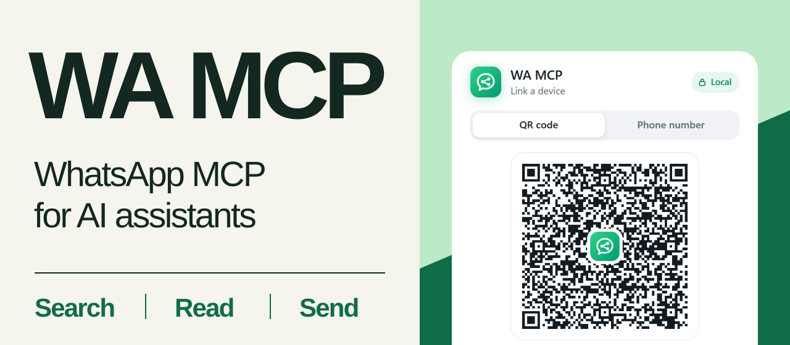
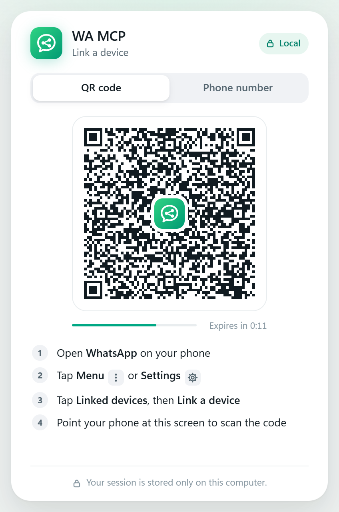
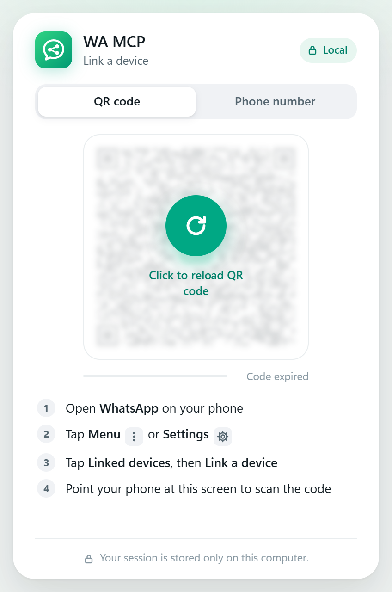
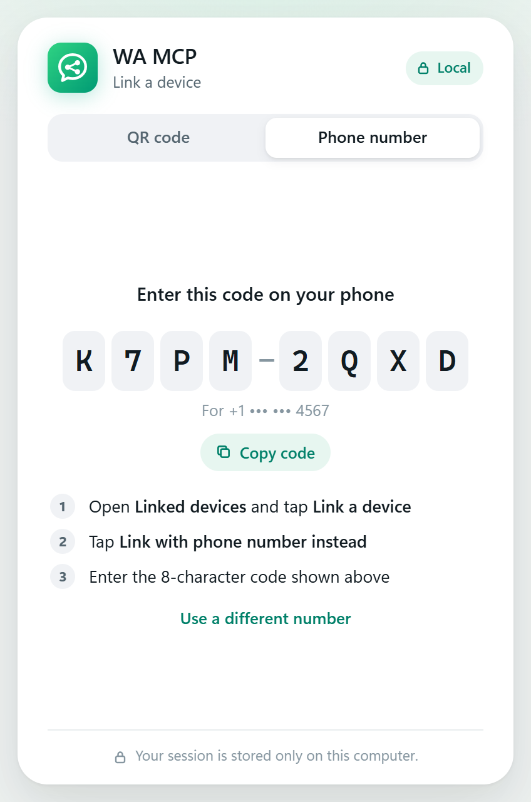
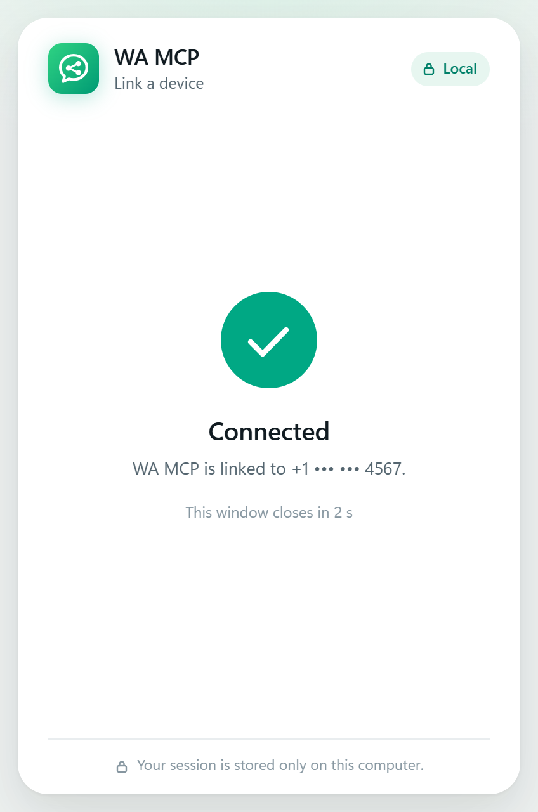
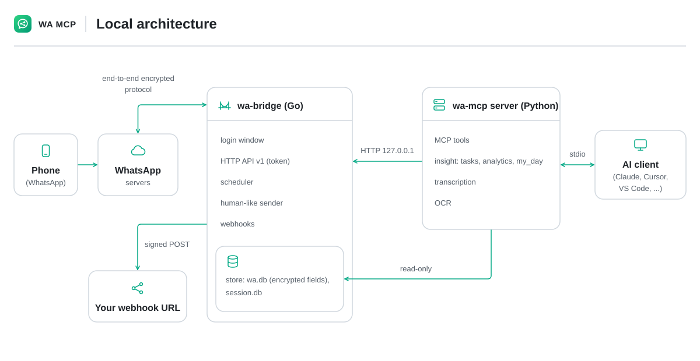

<p align="center">
  <picture>
    <source media="(prefers-color-scheme: dark)" srcset="assets/brand/banner-dark.svg">
    
  </picture>
</p>

<p align="center">
  <a href="LICENSE"></a>
  
  
  
  
  <a href="CHANGELOG.md"></a>
</p>

<p align="center">
  WhatsApp MCP for AI assistants: a local bridge and MCP server to search, read and send WhatsApp messages from Claude, Cursor, VS Code and other MCP clients.
</p>

<p align="center">
  
  
  
  
</p>

<p align="center">
  <sub>The login window: QR code, expired code, pairing by phone number, connected.</sub>
</p>

<p align="center">
  <a href="docs/getting-started.md">Getting started</a> |
  <a href="docs/tutorials/README.md">Tutorials</a> |
  <a href="docs/guides/configuration.md">Configuration</a> |
  <a href="docs/reference/tools.md">Tools</a> |
  <a href="docs/reference/http-api.md">HTTP API</a> |
  <a href="docs/security.md">Security</a> |
  <a href="docs/faq.md">FAQ</a>
</p>

## Features

| Area | What it does |
| --- | --- |
| Login window | Links your account from a small local window with a QR code or a pairing code for your phone number. The terminal prints the QR code as a fallback. |
| Several accounts | More than one WhatsApp number in one MCP server: one bridge per number with its own store and sending limits, `wa-bridge run-all` keeps them running, every tool takes an `account` argument and `my_day` covers all numbers. A config without accounts works as before. See [Several accounts](docs/guides/accounts.md). |
| History | Stores live messages and the history your phone sends after linking, and applies edits, deletions and reactions. Tools ask the phone for older pages, per chat or for the whole archive. |
| Chat import | Loads a WhatsApp "Export chat" file (`.txt`, or `.zip` with media) into the store, for history older than what the phone syncs. Reads Android and iPhone layouts in many date and clock formats, detects the date order, skips messages that are already stored and can be run again safely. Run it as a dry run first. |
| Media | Downloads images, video, audio, voice notes, documents and stickers. When the WhatsApp copy has expired, the bridge asks your phone to upload it again. |
| Search | Case-insensitive search in any script across messages, transcripts and extracted file text. The phone and LID chats of one person are merged. |
| Voice transcription | Turns voice notes into text with pluggable backends: faster-whisper, openai-whisper, whisper.cpp, any OpenAI-compatible endpoint or your own command. |
| Text from screenshots | Reads the text in photos and screenshots with a local OCR engine (tesseract or RapidOCR). The text is stored with the message, so search and `list_messages` find it. |
| Documents and archives | Reads text from PDF, DOCX, XLSX, PPTX, plain text and HTML files, lists ZIP and RAR archives without unpacking them, and reads public Google Docs links. |
| Chat analytics | Message volume, reply timing in both directions, message length, emoji, stickers, voice notes, formality and group roles. Compares up to 8 chats. |
| Tasks | Detects requests in chats with plain rules, tracks their status and finds watched words. No language model is involved. |
| `my_day` | One call that lists what needs you today: open requests, your own promises that are due, chats waiting for your answer, missed calls and scheduled sends. |
| Sending | Text, files, voice notes and stickers, with replies and mentions. Off by default. You approve each send in your client when it supports that; other clients need `sending.allow_confirm_flag`. |
| Human-like sending | Sending paces itself like a person would. The bridge marks the chat read first, shows the typing indicator for a time that depends on the message length, leaves a pause between messages, and follows quiet hours and per-hour limits. This makes automated sending look less mechanical. It does not guarantee anything. |
| Read receipts | Marks messages as read on request, or automatically if you turn that on. |
| Calls | Call history with direction, video flag, outcome and duration. |
| Scheduled messages | One-time, daily, weekly or monthly messages that the bridge sends without a running assistant. |
| Webhooks | Posts message, receipt, call, connection and scheduled events to your URLs with an HMAC-SHA256 signature and retries. |
| HTTP API | Local REST API with token authentication and an OpenAPI 3.1 document. |
| Embedding | The Go package `bridge/pkg/wabridge` runs the bridge inside another program, with hooks for every stored message and chat, extra HTTP routes and access to sending, media and history. `wa_mcp_server.embed.register` adds chosen tools to another MCP server. |
| Remote access | `wa-mcp serve --http` serves MCP over Streamable HTTP for remote clients such as claude.ai custom connectors, Claude Code, Cursor and VS Code. Per-device bearer tokens (stored hashed) or OAuth 2.1 with PKCE, dynamic registration and an owner approval page. Rate limits, Host and Origin checks, no CORS by default, and no plain HTTP off loopback without a TLS proxy. See [Connect remotely](docs/guides/remote-clients.md). |
| Server deployment | Docker images for the bridge and the server (non-root, read-only file system, health checks) and a Compose file with optional Caddy for automatic HTTPS. The login page works through the proxy with a one-time link. See [Run on a server](docs/guides/server.md). The images have not been built on a real Docker host yet; CI builds them and starts the preview stack on the first push. |
| AI providers (optional) | Off by default: your assistant does the thinking. You can set one background provider, Ollama, an OpenAI-compatible server or Anthropic, for `my_day` summaries and image descriptions. Keys come from environment variables, and daily call and input limits guard the cost. |
| Python SDK | The `wa_mcp` package: bridge client, read access to the local database, transcription and exports. |
| Encryption | On by default: message text, attachment names, reactions, transcripts and media keys in the database are encrypted with a key kept in the OS keystore (Windows DPAPI, macOS Keychain, Linux Secret Service), or with a passphrase or key file. The API token is kept there too, and on Windows the store folder gets EFS. See [Encryption and keys](docs/guides/encryption.md). |
| Session alerts | Records a remote logout, another client using this session, a new device on the account and a different account at login, and shows them in `bridge_status`, `GET /api/v1/status` and a `security` webhook. |

## Architecture

<p align="center">
  <picture>
    <source media="(prefers-color-scheme: dark)" srcset="assets/diagrams/architecture-dark.svg">
    
  </picture>
</p>

## Quick start

You need Go 1.26 or newer, [uv](https://docs.astral.sh/uv/) and a phone with WhatsApp. `wa-bridge` (Go)
keeps a local database and an API. `wa-mcp` (Python) is the MCP server that reads that database and
calls the API.

```bash
git clone https://github.com/tsahospital-beep/wa-mcp.git
cd wa-mcp
go build -C bridge -o ../wa-bridge ./cmd/wa-bridge    # on Windows use ../wa-bridge.exe
./wa-bridge                                           # opens the login window
uv sync                                               # in a second terminal
```

In the login window scan the QR code with WhatsApp: Menu or Settings, Linked devices, Link a device. When
the window shows Connected it closes itself, and the bridge keeps running. The full walkthrough, including
pairing by phone number, is in [Getting started](docs/getting-started.md).

## Connect an AI client

The server speaks MCP over stdio, so any MCP client can start it. For Claude Desktop, Cursor and Windsurf
add this to the client's MCP config file (see [Connect an MCP client](docs/guides/mcp-clients.md) for the
file locations):

```json
{
  "mcpServers": {
    "wa-mcp": {
      "command": "uv",
      "args": [
        "run", "--directory", "/path/to/wa-mcp",
        "wa-mcp", "--config", "/path/to/wa-mcp/config.json"
      ]
    }
  }
}
```

Claude Code:

```bash
claude mcp add wa-mcp -- uv run --directory /path/to/wa-mcp wa-mcp --config /path/to/wa-mcp/config.json
```

VS Code, in `.vscode/mcp.json`:

```json
{
  "servers": {
    "wa-mcp": {
      "type": "stdio",
      "command": "uv",
      "args": [
        "run", "--directory", "/path/to/wa-mcp",
        "wa-mcp", "--config", "/path/to/wa-mcp/config.json"
      ]
    }
  }
}
```

Then ask the assistant to run `bridge_status` to check the setup.

## Tutorials

Step-by-step lessons for install, first login, clients, tasks, voice, screenshots, imports, sending,
several accounts, Docker, remote access, webhooks and security are in the
[tutorials index](docs/tutorials/README.md).

## Example: "What are my tasks today?"

```text
You:        What are my tasks today?

Assistant:  (calls my_day for 2026-11-23)

            Four things need you today.

            Alice asked for the updated invoice yesterday at 16:40 and wants it by the end of the
            day. It is still open.

            On Sunday you told Bob "I will send you the photos tomorrow". That promise is due today.

            The Book club group asked "Which day works for the next meeting?" about 95 minutes ago.
            Nobody has answered yet.

            A reminder for the Book club is scheduled to go out at 18:00.
```

`my_day` runs on your machine and uses plain rules. The assistant only phrases the result.

## Configuration

The bridge and the server work without a config file. To change something, copy
[`config.example.json`](config.example.json) to `config.json`. It lists every key with its default.
Settings can also come from environment variables such as `WA_MCP_API_LISTEN`, and the bridge warns about
keys it does not know. For example, to allow sending and make transcription lighter:

```json
{
  "sending": { "enabled": true },
  "transcription": { "model": "small" }
}
```

All keys are described in [Configuration](docs/guides/configuration.md). Sending has its own page:
[Sending](docs/guides/sending.md).

## Voice transcription

Transcription is optional. Pick a backend with `transcription.backend`:

| Backend | Notes |
| --- | --- |
| `faster-whisper` | Default. Runs on CPU or an NVIDIA GPU. |
| `openai-whisper` | Reference implementation on PyTorch. |
| `whisper.cpp` | A separate `whisper-cli` program and a ggml model. |
| `http` | Any OpenAI-compatible `/v1/audio/transcriptions` server. |
| `command` | Any program that prints the text of a WAV file. |

ffmpeg must be on your `PATH`. Install a backend with the script for your system:

```bash
scripts/install_whisper.sh --backend faster-whisper --model large-v3 --download
```

```powershell
scripts\install_whisper.ps1 -Backend faster-whisper -Model large-v3 -Download
```

See [Voice transcription](docs/guides/transcription.md) for the details and for keeping the packages
across `uv sync`.

## Use in your own project

Read the local database from Python:

```python
from wa_mcp import config, db, people

cfg = config.load("config.json")
db.connect(cfg)
people.connect(cfg)

for m in db.messages(after="2026-11-01", query="invoice", limit=5):
    print(m["time"], people.name_of(m["conv"]), m["body"][:60])
```

Receive webhooks and check the HMAC signature and the timestamp:

```python
import hashlib, hmac, json, os, time
from http.server import BaseHTTPRequestHandler, HTTPServer

SECRET = os.environ["WA_MCP_WEBHOOK_SECRET"].encode()


class Hook(BaseHTTPRequestHandler):
    def do_POST(self):
        body = self.rfile.read(int(self.headers.get("Content-Length", 0)))
        stamp = self.headers.get("X-WA-MCP-Timestamp", "")
        signed = stamp.encode() + b"." + body
        expected = "sha256=" + hmac.new(SECRET, signed, hashlib.sha256).hexdigest()
        fresh = stamp.isdigit() and abs(time.time() - int(stamp)) <= 300
        if not (fresh and hmac.compare_digest(expected, self.headers.get("X-WA-MCP-Signature", ""))):
            self.send_response(401)
            self.end_headers()
            return
        print(json.loads(body)["event"])
        self.send_response(204)
        self.end_headers()


HTTPServer(("127.0.0.1", 9000), Hook).serve_forever()
```

Call the HTTP API:

```bash
TOKEN=$(./wa-bridge api-token)
curl -H "Authorization: Bearer $TOKEN" "http://127.0.0.1:8080/api/v1/messages?query=invoice&limit=5"
```

More in [Webhooks](docs/guides/webhooks.md), the [HTTP API](docs/reference/http-api.md) and the list of
[MCP tools](docs/reference/tools.md).

## Security and privacy

- Everything stays on your machine. The API and the login window listen on 127.0.0.1 only. There is no
  telemetry.
- Every API request needs the API token, which the bridge keeps in the OS keystore of your user
  (`wa-bridge api-token` prints it). The store folder is readable by your user only, and the login link
  works once.
- Message text in the database is encrypted by default. The key is kept by Windows DPAPI, the macOS
  Keychain or the Linux Secret Service for your user, so a copy of the store on another computer or in
  another Windows account cannot be read. On Windows the store folder, including the WhatsApp session, is
  encrypted with EFS as well; on macOS and Linux use full disk encryption for the session file.
- The bridge reports session events, such as another client using this session or a new linked device,
  in `bridge_status`, the status endpoint and a `security` webhook.
- Sending is disabled by default. You approve each send in your client when it can ask. Clients that
  cannot ask can send only if you set `sending.allow_confirm_flag`; they then pass `confirm=true`, which
  the model sets itself, so that path is a weaker check. The
  bridge adds limits, quiet hours and duplicate protection, and it only sends files from the downloads
  and exports folders unless you allow more.
- Message text is untrusted input. The server tells clients not to follow instructions found in it.
- Webhooks are signed with a timestamp so that replays can be refused.
- Remote access is opt-in. `wa-mcp serve --http` needs a token or an OAuth grant you approved, and it does
  not serve plain HTTP beyond loopback without a TLS proxy. See [Remote mode security](docs/security/remote.md).
- The encryption covers message text, attachment names, reactions, transcripts and media keys. It does
  not cover downloads, exports, chat ids, titles or timestamps.
- An administrator or malware running as your user can still read the store and ask the keystore for the
  key. Check Linked devices on your phone from time to time.

Details are in [docs/security.md](docs/security.md), keys and modes in
[Encryption and keys](docs/guides/encryption.md) and the threat model in
[docs/security/audit.md](docs/security/audit.md). To report a vulnerability, see
[SECURITY.md](SECURITY.md).

## License

[MIT](LICENSE). Dependency licenses are listed in [THIRD_PARTY_NOTICES.md](THIRD_PARTY_NOTICES.md).
