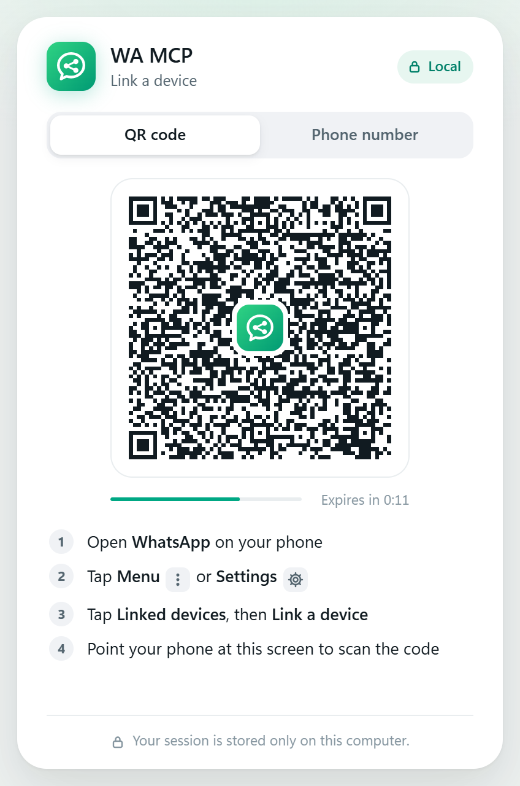
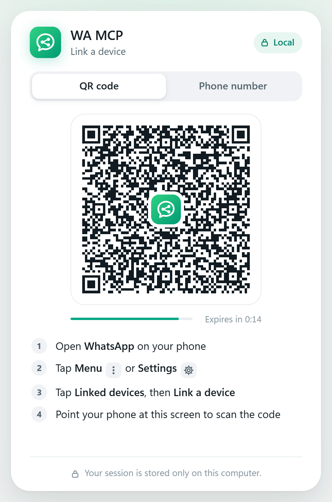
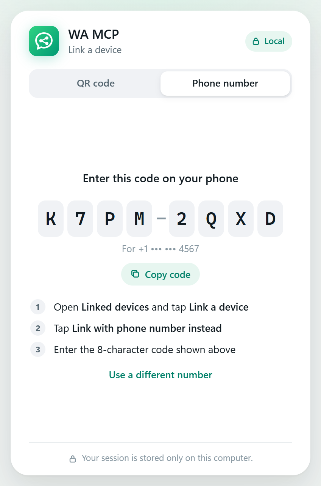

# Getting started

This guide takes you from a fresh clone to an AI assistant that can read your WhatsApp chats. It takes
about ten minutes. Sending stays off until you turn it on.

## What you need

- A phone with the WhatsApp account you want to link.
- [Go](https://go.dev/dl/) 1.26 or newer, to build the bridge.
- [uv](https://docs.astral.sh/uv/getting-started/installation/), to install the Python packages. uv can
  also download Python 3.11 or newer for you.
- An MCP client such as Claude Desktop, Claude Code, Cursor, Windsurf or VS Code.
- Optional: [ffmpeg](https://ffmpeg.org/) on your `PATH`, needed for voice notes, stickers and
  transcription.
- Optional: a Chromium-based browser (Edge, Chrome, Brave or Chromium). The login window opens as a
  small app window in the first one the bridge finds. Without one it opens in your default browser.

## 1. Build the bridge and install the server

```bash
git clone https://github.com/tsahospital-beep/wa-mcp.git
cd wa-mcp
go build -C bridge -o ../wa-bridge ./cmd/wa-bridge
uv sync
```

On Windows, name the output `../wa-bridge.exe`:

```powershell
go build -C bridge -o ../wa-bridge.exe ./cmd/wa-bridge
```

Check the result:

```bash
./wa-bridge --version
uv run wa-mcp --help
```

`go build` downloads the Go modules on the first run. `uv sync` creates `.venv` with the SDK, the MCP
server and the optional packages for encryption and file text extraction.

## 2. Configuration (optional)

The bridge and the MCP server work without a config file. Every key has a safe default: sending is off,
and the API listens on `127.0.0.1:8080`. To change something, copy the example and edit it:

```bash
cp config.example.json config.json
```

Both programs read the same `config.json` from the folder you start them in. The bridge prints a warning
for keys it does not know, which usually points to a typo. See [Configuration](guides/configuration.md)
for every key.

## 3. Link your account

Start the bridge from the repository folder:

```bash
./wa-bridge
```

On first start there is no linked device, so a login window opens. The window listens on 127.0.0.1 only.
Its address carries a one-time token: the first visit exchanges it for a session cookie and the token is
spent. The same QR code is also printed in the terminal.

On the phone, open WhatsApp, tap **Menu** or **Settings**, then **Linked devices**, then **Link a device**.
Point the camera at the code in the window.

<p>
  
  
  
</p>

A code is valid for a short time. A countdown under the code shows how long is left. When it runs out the
code blurs and the window offers **Click to reload QR code**. Click it to get a fresh code. In the
terminal you can press Enter for the same effect.

### Link with a phone number instead

If scanning is not possible, open the **Phone number** tab, enter the number of the account with the
country code and choose **Next**. The window shows an 8-character code. On the phone choose **Link a
device**, then **Link with phone number instead**, and type the code.

<p>
  
  
  
</p>

When the phone confirms, the window shows **Connected** and closes itself after a moment. The session is
stored in `store/session.db`, so the next start connects without a login. If you remove the device
under **Linked devices** on the phone, or WhatsApp logs it out, the bridge shows the login window again.

The terminal shows the window address once, in a line that starts with `Login window: http://127.0.0.1:`.
The window that the bridge opens has already used that token, so the printed address only works when the
automatic window did not open, for example with `login.open_window` set to `false`. Open it in a browser
then. If the token was spent and the window is gone, stop the bridge with Ctrl+C and start it again for a
new address, or scan the QR code in the terminal. To look at the window without a WhatsApp account, run
`./wa-bridge --login-preview`. It shows fake codes and never connects.

A store belongs to one WhatsApp account. If you link a different account to a store that already has one,
the bridge refuses it and unlinks the device again. Use a second config file with its own `store_dir` for
the other account. Only one bridge can use a store at a time. A second start in the same folder stops with
`another bridge is using ...`.

The bridge limits the `store` folder to your user (a protected access list on Windows, mode 0700 on
macOS and Linux) and warns when `store_dir` is outside your home folder.

## 4. Let it sync

After linking, the phone sends recent history and the bridge stores it in `store/wa.db`. New messages are
stored as they arrive. Keep the bridge running while this happens. Older messages can be requested from
the phone later with the history tools.

Check the state from another terminal:

```bash
curl -H "Authorization: Bearer $(./wa-bridge api-token)" http://127.0.0.1:8080/api/v1/status
```

The answer shows `"connected":true,"logged_in":true` and your number with most digits masked. In Windows
PowerShell use `curl.exe`. The token is kept in the OS keystore, and `wa-bridge api-token` prints it:

```powershell
curl.exe -H "Authorization: Bearer $(.\wa-bridge.exe api-token)" http://127.0.0.1:8080/api/v1/status
```

## 5. Connect an assistant

Add the server to your MCP client. For Claude Desktop, open Settings, then Developer, then Edit Config, and add:

```json
{
  "mcpServers": {
    "wa-mcp": {
      "command": "uv",
      "args": [
        "run", "--directory", "/path/to/wa-mcp",
        "wa-mcp", "--config", "/path/to/wa-mcp/config.json"
      ]
    }
  }
}
```

Replace `/path/to/wa-mcp` with the folder of your clone. On Windows use forward slashes, for example
`C:/Users/you/wa-mcp`. Restart the client. The other clients are covered in
[Connect an MCP client](guides/mcp-clients.md).

Then ask the assistant to run `bridge_status`. It reports whether the database exists, whether the
bridge is reachable and logged in, whether sending is enabled and which transcription backend is set.
After that try:

- "List my most recent chats."
- "What did I talk about with Alice last week?"
- "What are my tasks today?"

## Keep the bridge running

The MCP server reads `store/wa.db` directly and read-only, so searching and reading work even when the
bridge is stopped, but the data is only as fresh as the last time the bridge ran. The bridge has to run
for live messages, history requests, media downloads, sending, scheduled messages and webhooks.

Stop it with Ctrl+C. It shuts down cleanly.

## Update

```bash
git pull
go build -C bridge -o ../wa-bridge ./cmd/wa-bridge
uv sync
```

The database schema is migrated automatically on start. A database written by a newer bridge is refused
with a message asking you to update.

## Next steps

- [Configuration](guides/configuration.md)
- [Enable sending](guides/sending.md)
- [Voice transcription](guides/transcription.md)
- [Webhooks](guides/webhooks.md)
- [MCP tools](reference/tools.md) and [HTTP API](reference/http-api.md)
- [Security](security.md) and [FAQ](faq.md)
