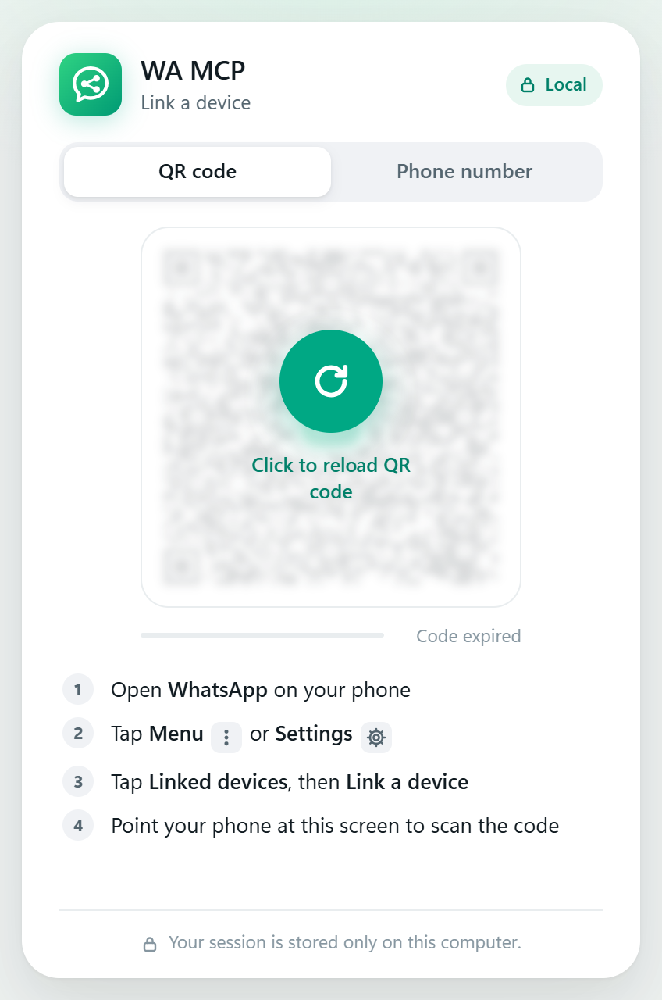
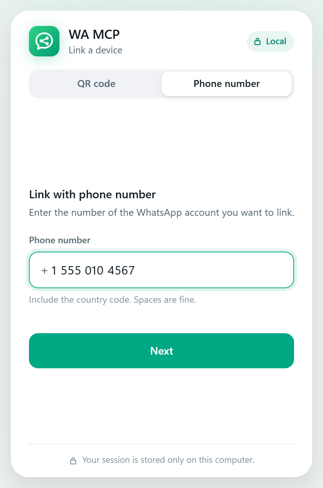
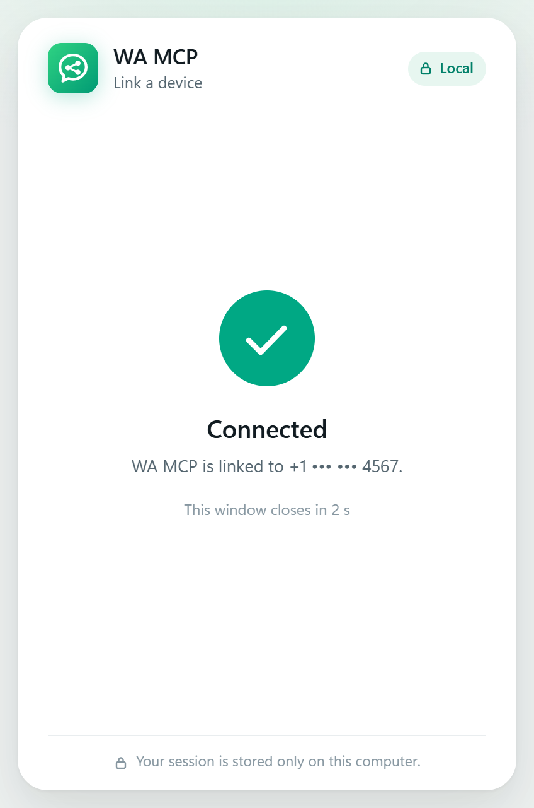

# Getting started

Your MCP client starts the Python server. A separate bridge links your phone, syncs messages and
serves live requests. Sending stays off by default.

## What you need

- A phone with the WhatsApp account you want to link.
- [Go](https://go.dev/dl/) 1.26 or newer for the native bridge, or Docker Engine for the bridge image.
- [uv](https://docs.astral.sh/uv/getting-started/installation/) for the buttons and the Claude Desktop
  bundle, or pipx with Python 3.11 or newer for manual setup.
- An MCP client such as Claude Desktop, Claude Code, Cursor, Windsurf or VS Code.
- Optional: [ffmpeg](https://ffmpeg.org/) on your `PATH`, needed for voice notes, stickers and
  transcription.
- Optional: a Chromium-based browser (Edge, Chrome, Brave or Chromium). The login window opens as a
  small app window when the bridge finds a supported browser. Otherwise, run `wa-bridge login-url`
  during login and open the link yourself.

## 1. Install the server from PyPI

Check the v0.1.0 entry point from any directory. The package is `wa-mcp-server` and its executable is `wa-mcp`.

```bash
uvx --from wa-mcp-server==0.1.0 wa-mcp --help
```

For a persistent installation, use pipx. The SDK extras support the default encrypted store and
document text extraction.

```bash
pipx install wa-mcp-server
pipx inject --force wa-mcp-server 'wa-mcp-sdk[encryption,files]'
wa-mcp --help
```

## 2. Set up one bridge

### Build the native bridge

```bash
git clone https://github.com/tsahospital-beep/wa-mcp.git
cd wa-mcp
go build -C bridge -o ../wa-bridge ./cmd/wa-bridge
cp config.example.json config.json
```

On Windows, name the output `../wa-bridge.exe`:

```powershell
go build -C bridge -o ../wa-bridge.exe ./cmd/wa-bridge
```

Check the result:

```bash
./wa-bridge --version
```

The example keeps the API on loopback and the message store beside the config. Both programs resolve
relative settings from the config's directory. See [Configuration](guides/configuration.md) for the defaults.

### Run the bridge in Docker

On Linux, the host server and container can share a private directory. For a fresh installation,
start in a new, empty directory owned by your user. Create the key once and keep it for future starts.

```bash
umask 077
openssl rand -hex -out store.key 32
cat > config.json <<'EOF'
{
  "encryption": { "mode": "keyfile", "key_file": "store.key" }
}
EOF
```

Run the published image from that directory. The user ID keeps the files readable by your desktop
client. Docker publishes the API on host loopback. The container prints the QR code.

```bash
docker run --rm -it --name wa-mcp-bridge \
  --user "$(id -u):$(id -g)" \
  --mount "type=bind,src=$PWD,dst=/data" \
  -p 127.0.0.1:8080:8080 \
  -e WA_MCP_CONFIG=/data/config.json \
  -e WA_MCP_API_LISTEN=0.0.0.0:8080 \
  ghcr.io/tsahospital-beep/wa-mcp-bridge:0.1.0
```

The desktop client uses the host copy of `config.json`. Leave its API address at the default
`127.0.0.1:8080`. For a deployment with both components in containers, see [Run on a server](guides/server.md).

## 3. Link your account

For the native build, start the bridge from the directory containing `config.json`.

```bash
./wa-bridge
```

On the first native start, a login window opens. With Docker, scan the QR code in the terminal.
The native login window listens on 127.0.0.1 only.
Its address carries a one-time token: the first visit exchanges it for a session cookie and the token is
spent. The same QR code is also printed in the terminal.

On the phone, open WhatsApp, tap **Menu** or **Settings**, then **Linked devices**, then **Link a device**.
Point the camera at the code in the window.

<p>
  
  
  
</p>

A code is valid for a short time. A countdown under the code shows how long is left. When it runs out the
code blurs and the window offers **Click to reload QR code**. Click it to get a fresh code. In the
terminal you can press Enter for the same effect.

### Link with a phone number instead

If scanning is not possible, open the **Phone number** tab, enter the number of the account with the
country code and choose **Next**. The window shows an 8-character code. On the phone choose **Link a
device**, then **Link with phone number instead**, and type the code.

<p>
  
  
  
</p>

When the phone confirms, the window shows **Connected** and closes itself after a moment. The session is
stored in `store/session.db`, so the next start connects without a login. If you remove the device
under **Linked devices** on the phone, or WhatsApp logs it out, the bridge shows the login window again.

The terminal shows the window address once, in a line that starts with `Login window: http://127.0.0.1:`.
The window that the bridge opens has already used that token, so the printed address only works when the
automatic window did not open, for example with `login.open_window` set to `false`. Open it in a browser
then. If the token was spent and the window is gone, stop the bridge with Ctrl+C and start it again for a
new address, or scan the QR code in the terminal. To look at the window without a WhatsApp account, run
`./wa-bridge --login-preview`. It shows fake codes and never connects.

A store belongs to one WhatsApp account. If you link a different account to a store that already has one,
the bridge refuses it and unlinks the device again. Use a second config file with its own `store_dir` for
the other account. Only one bridge can use a store at a time. A second start in the same folder stops with
`another bridge is using ...`.

The bridge limits the `store` folder to your user (a protected access list on Windows, mode 0700 on
macOS and Linux) and warns when `store_dir` is outside your home folder.

## 4. Let it sync

After linking, the phone sends recent history and the bridge stores it in `store/wa.db`. New messages are
stored as they arrive. Keep the bridge running while this happens. Older messages can be requested from
the phone later with the history tools.

For Docker, run `docker exec wa-mcp-bridge /usr/local/bin/wa-bridge health`. For the native bridge,
check the state from another terminal.

```bash
curl -H "Authorization: Bearer $(./wa-bridge api-token)" http://127.0.0.1:8080/api/v1/status
```

The answer shows `"connected":true,"logged_in":true` and your number with most digits masked. In Windows
PowerShell use `curl.exe`. The token is kept in the OS keystore, and `wa-bridge api-token` prints it:

```powershell
curl.exe -H "Authorization: Bearer $(.\wa-bridge.exe api-token)" http://127.0.0.1:8080/api/v1/status
```

## 5. Connect your MCP client

Use the [install buttons](../README.md#quick-start) with `WA_MCP_CONFIG` set to the absolute config
path in the environment your client inherits. For manual setup, replace `CONFIG_FILE` below with
that path. Each argument is a separate string, including paths with spaces.

```json
{
  "mcpServers": {
    "wa-mcp": {
      "command": "uvx",
      "args": [
        "--from", "wa-mcp-server==0.1.0", "--with", "wa-mcp-sdk[encryption,files]",
        "wa-mcp", "--config", "CONFIG_FILE"
      ]
    }
  }
}
```

With pipx, set the command to `wa-mcp` and keep just `["--config", "CONFIG_FILE"]` as the arguments.
Restart the client. See [Connect an MCP client](guides/mcp-clients.md) for client-specific settings.

Run `bridge_status` in your client. It reports whether the database exists, whether the
bridge is reachable and logged in, whether sending is enabled and which transcription backend is set.
After that try:

- "List my most recent chats."
- "Which chats were active last week?"
- "What are my tasks today?"

## Keep the bridge running

The MCP server reads `store/wa.db` directly and read-only, so searching and reading work even when the
bridge is stopped, but the data is only as fresh as the last time the bridge ran. The bridge has to run
for live messages, history requests, media downloads, sending, scheduled messages and webhooks.

Stop it with Ctrl+C. It shuts down cleanly.

## Update

```bash
git pull
go build -C bridge -o ../wa-bridge ./cmd/wa-bridge
```

For Docker, use the new release tag with the existing data directory and key. Update the package pins
in your uvx client config or run `pipx upgrade wa-mcp-server --include-injected`.

The database schema is migrated automatically on start. A database written by a newer bridge is refused
with a message asking you to update.

## Next steps

- [Configuration](guides/configuration.md)
- [Enable sending](guides/sending.md)
- [Voice transcription](guides/transcription.md)
- [Webhooks](guides/webhooks.md)
- [MCP tools](reference/tools.md) and [HTTP API](reference/http-api.md)
- [Security](security.md) and [FAQ](faq.md)
