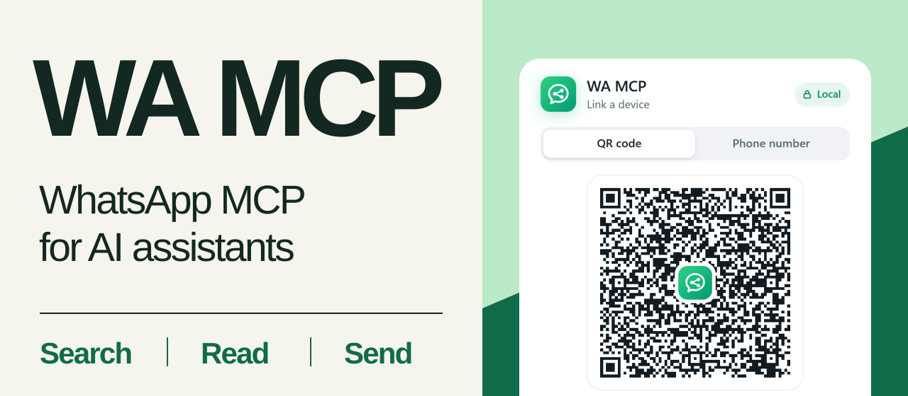
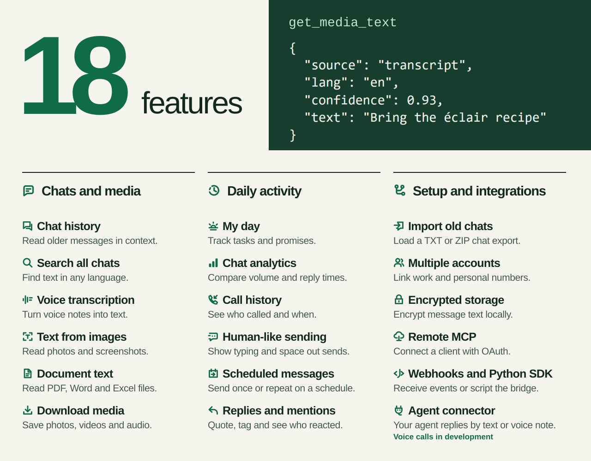
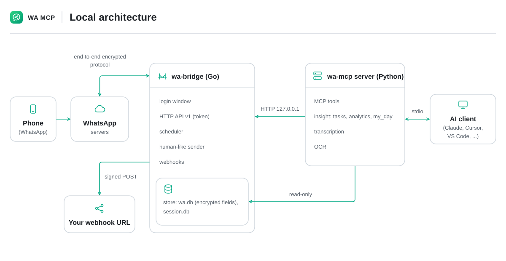

> El [README en inglés](../../README.md) es la referencia del proyecto y puede estar más actualizado.

<p align="center">
  <picture>
    <source media="(prefers-color-scheme: dark)" srcset="../../assets/brand/banner-dark.svg">
    
  </picture>
</p>

<p align="center">
  <a href="../../LICENSE"></a>
  
  
  
  
  <a href="../../CHANGELOG.md"></a>
</p>

<p align="center">
  Un puente local y un servidor MCP conectan WhatsApp con asistentes de IA para que puedas buscar, leer y enviar mensajes desde Claude, Cursor, VS Code y otros clientes MCP.
</p>

<p align="center">
  <a href="../getting-started.md">Primeros pasos</a> |
  <a href="../tutorials/README.md">Tutoriales</a> |
  <a href="../guides/configuration.md">Configuración</a> |
  <a href="../reference/tools.md">Herramientas</a> |
  <a href="../reference/http-api.md">API HTTP</a> |
  <a href="../security.md">Seguridad</a> |
  <a href="../faq.md">Preguntas frecuentes</a>
</p>

## Pruébalo sin teléfono

Si tienes uv instalado, `uvx wa-mcp-server --demo` abre un archivo ficticio con ocho chats. La demo requiere WA MCP 0.2.1 o posterior. Una vez instalada, funciona sin conexión y sin el puente de Go.

[](https://cursor.com/install-mcp?name=wa-mcp-demo&config=eyJjb21tYW5kIjoidXZ4IiwiYXJncyI6WyJ3YS1tY3Atc2VydmVyIiwiLS1kZW1vIl19)
[](https://vscode.dev/redirect?url=vscode%3Amcp%2Finstall%3F%257B%2522name%2522%253A%2522wa-mcp-demo%2522%252C%2522type%2522%253A%2522stdio%2522%252C%2522command%2522%253A%2522uvx%2522%252C%2522args%2522%253A%255B%2522wa-mcp-server%2522%252C%2522--demo%2522%255D%257D)

**Claude Code**

```sh
claude mcp add wa-mcp-demo -- uvx wa-mcp-server --demo
```

**Claude Desktop (`claude_desktop_config.json`) y Cursor (`.cursor/mcp.json`)**

```json
{
  "mcpServers": {
    "wa-mcp-demo": { "command": "uvx", "args": ["wa-mcp-server", "--demo"] }
  }
}
```

**VS Code (`.vscode/mcp.json`)**

```json
{
  "servers": {
    "wa-mcp-demo": { "type": "stdio", "command": "uvx", "args": ["wa-mcp-server", "--demo"] }
  }
}
```

Pregunta «¿Qué tareas tengo hoy?». Luego busca «blue umbrella» y lee la transcripción de la nota de voz. [Tutorial de dos minutos](../tutorials/00-demo.md)

## Funciones

<p align="center">
  <picture>
    <source media="(prefers-color-scheme: dark) and (max-width: 600px)" srcset="../../assets/features/features-dark-mobile.svg">
    <source media="(max-width: 600px)" srcset="../../assets/features/features-light-mobile.svg">
    <source media="(prefers-color-scheme: dark)" srcset="../../assets/features/features-dark.svg">
    
  </picture>
</p>

| Área | Función |
| --- | --- |
| Ventana de inicio de sesión | Vincula tu cuenta desde una ventana local con un código QR o un código de vinculación para tu número de teléfono. También puedes escanear el código QR desde el terminal. |
| Varias cuentas | Usa varios números de WhatsApp en un mismo servidor MCP. Cada número tiene su propio puente, almacenamiento y límites de envío. `wa-bridge run-all` mantiene los puentes en marcha. Todas las herramientas aceptan el argumento `account` y `get_my_day` consulta todos los números. Las configuraciones sin cuentas siguen funcionando como antes. Consulta [Varias cuentas](../guides/accounts.md). |
| Historial | Guarda los mensajes que llegan y el historial que envía el teléfono al vincularlo. Aplica las ediciones, eliminaciones y reacciones. Las herramientas pueden pedir al teléfono mensajes anteriores por chat o para todo el historial. |
| Importación de chats | Importa un archivo generado con «Exportar chat» de WhatsApp (`.txt` o `.zip` con archivos multimedia) para recuperar mensajes anteriores a los que sincroniza el teléfono. Admite archivos de Android y iPhone con distintos formatos de fecha y hora y detecta el orden de los componentes de la fecha. Puedes repetir la importación porque omite los mensajes que ya están guardados. Haz primero una simulación. |
| Archivos multimedia | Descarga imágenes, vídeos, audio, notas de voz, documentos y stickers. Si la copia de WhatsApp ha caducado, el puente pide al teléfono que vuelva a subir el archivo. |
| Búsqueda | Busca en mensajes, transcripciones y texto extraído de archivos en cualquier sistema de escritura, sin distinguir entre mayúsculas y minúsculas. La búsqueda reúne los chats de una misma persona identificados por su número y por su LID. |
| Transcripción de voz | Convierte notas de voz en texto con faster-whisper, openai-whisper, whisper.cpp, un endpoint compatible con OpenAI o un comando propio. |
| Texto de capturas de pantalla | Un motor de OCR local (tesseract o RapidOCR) lee texto de fotos y capturas de pantalla. El texto se guarda con el mensaje y aparece en las búsquedas y en `list_messages`. |
| Documentos y archivos comprimidos | Lee texto de archivos PDF, DOCX, XLSX, PPTX, de texto plano y HTML. Enumera el contenido de archivos ZIP y RAR sin descomprimirlos y lee documentos públicos mediante enlaces de Google Docs. |
| Análisis de chats | Compara hasta ocho chats por volumen y longitud de los mensajes, tiempo de respuesta en ambos sentidos, uso de emojis, stickers y notas de voz, grado de formalidad y roles dentro del grupo. |
| Tareas | Identifica peticiones en los chats mediante reglas sencillas, sigue su estado y busca las palabras que hayas elegido supervisar. Funciona sin un modelo de lenguaje. |
| `get_my_day` | Con una llamada puedes consultar las peticiones abiertas, los compromisos tuyos que vencen hoy, los chats pendientes de respuesta, las llamadas perdidas y los envíos programados. |
| Envío | Envía texto, archivos, notas de voz y stickers, con respuestas y menciones. El envío está desactivado por defecto. Apruebas cada envío en el cliente si este admite confirmaciones. Los demás clientes necesitan `sending.allow_confirm_flag`. |
| Ritmo de envío | El puente marca primero el chat como leído, muestra el indicador de escritura durante un tiempo que depende de la longitud del mensaje y deja una pausa entre envíos. Respeta las horas de silencio y los límites por hora. Los envíos automáticos tienen así un ritmo más natural, aunque esto no ofrece ninguna garantía. |
| Confirmaciones de lectura | Marca los mensajes como leídos cuando lo pidas o activa la confirmación automática. |
| Llamadas | Consulta el historial con la dirección de la llamada, si fue de vídeo, el resultado y la duración. La función para hacer y contestar llamadas con un agente está en desarrollo. Consulta la [hoja de ruta](#hoja-de-ruta). |
| Mensajes programados | El puente envía mensajes una sola vez o con frecuencia diaria, semanal o mensual, sin necesidad de tener el asistente en marcha. |
| [Conector de agentes](../guides/agent-connector.md) | Conecta tu propia API de respuestas o tu modelo. Prepara, aprueba o envía texto y notas de voz en los chats que hayas autorizado. |
| Webhooks | Publica en tus URL eventos de mensajes, confirmaciones, llamadas, conexión, envíos programados y seguridad. El puente reintenta las entregas fallidas y firma las peticiones si configuras un secreto. |
| API HTTP | API REST local con autenticación por token y una especificación OpenAPI 3.1. |
| Integración en otros programas | El paquete de Go `bridge/pkg/wabridge` ejecuta el puente dentro de otro programa, con hooks para cada mensaje y chat guardado, rutas HTTP adicionales y acceso a las funciones de envío, archivos multimedia e historial. Con `wa_mcp_server.embed.register` puedes añadir herramientas concretas a otro servidor MCP. |
| Acceso remoto | `wa-mcp serve --http` ofrece MCP mediante Streamable HTTP a clientes remotos como los conectores personalizados de claude.ai, Claude Code, Cursor y VS Code. Admite tokens bearer por dispositivo, almacenados como hashes, u OAuth 2.1 con PKCE, registro dinámico y una página de aprobación para el propietario. Incluye límites de peticiones, comprobaciones de Host y Origin y soporte para un proxy TLS. CORS está desactivado por defecto. Consulta [Conexión remota](../guides/remote-clients.md). |
| Despliegue en un servidor | Las imágenes Docker del puente y el servidor se ejecutan sin root, con un sistema de archivos de solo lectura y comprobaciones de estado. El archivo de Compose permite usar Caddy para configurar HTTPS automáticamente. La página de inicio de sesión funciona a través del proxy con un enlace de un solo uso. Consulta [Ejecución en un servidor](../guides/server.md). Las imágenes aún no se han compilado en un host Docker real. La integración continua las compila y levanta el entorno de prueba con cada push a `main`. |
| Proveedores de IA (opcional) | Por defecto, el asistente se encarga del análisis. Puedes configurar un proveedor en segundo plano para los resúmenes de `get_my_day` y las descripciones de imágenes: Ollama, un servidor compatible con OpenAI o Anthropic. Las claves se leen de variables de entorno. Los límites diarios de llamadas y de datos de entrada ayudan a controlar el coste. |
| SDK de Python | El paquete `wa_mcp` incluye un cliente para el puente, acceso de lectura a la base de datos local, transcripción y exportación. |
| Cifrado | Está activado por defecto para el texto de los mensajes, nombres de adjuntos, reacciones, transcripciones y claves de los archivos multimedia de la base de datos. La clave se guarda en el almacén del sistema (Windows DPAPI, macOS Keychain o Linux Secret Service). También puedes usar una frase de contraseña o un archivo de clave. El token de la API recibe la misma protección. En Windows, la carpeta de almacenamiento también se cifra con EFS. Consulta [Cifrado y claves](../guides/encryption.md). |
| Alertas de sesión | Registra los cierres de sesión remotos, el uso de la sesión por otro cliente, la vinculación de un dispositivo nuevo y los inicios de sesión con otra cuenta. Puedes ver estos eventos en `get_bridge_status`, en `GET /api/v1/status` y en el webhook `security`. |

## Comparación con otros proyectos

La tabla recoge las funciones que ofrece cada proyecto. El cifrado se refiere al texto de los mensajes que cifra la aplicación. La importación consiste en leer un chat exportado desde WhatsApp. «Varias cuentas» significa que una sola instalación admite más de un número vinculado. «Parcial» indica soporte limitado o sin confirmar.

| Función | WA MCP | [finereli](https://github.com/finereli/whatsapp-mcp) | [verygoodplugins](https://github.com/verygoodplugins/whatsapp-mcp) | [felipeadeildo](https://github.com/felipeadeildo/whatsapp-mcp) | [jlucaso1](https://github.com/jlucaso1/whatsapp-mcp-ts) | [BrOrlandi](https://github.com/BrOrlandi/whatsapp-mcp-server) |
| --- | --- | --- | --- | --- | --- | --- |
| Envío de mensajes | Sí | No | Sí | Sí | Sí | Sí |
| Envío de archivos multimedia y notas de voz | Sí | No | Sí | No | No | Parcial |
| Transcripción de voz | Sí | Sí | Sí | Sí | No | Sí |
| Texto de imágenes (OCR) | Sí | No | No | Sí | No | No |
| Texto de documentos | Sí | Parcial | No | Sí | No | No |
| Cifrado en reposo | Sí | Sí | No | No | No | No |
| Ritmo y límites de envío | Sí | No | Parcial | Parcial | No | Parcial |
| Mensajes programados | Sí | No | No | No | No | No |
| Varias cuentas | Sí | Sí | No | Sí | No | Sí |
| Webhooks | Sí | No | Sí | Sí | No | Sí |
| MCP remoto por HTTP con OAuth | Sí | Sí | Parcial | Sí | No | Parcial |
| Docker | Sí | Sí | No | No | Sí | Sí |
| Importación de chats | Sí | No | No | No | No | No |
| Licencia | MIT | MIT | MIT | GPL-3.0 | ISC | MIT |
| Lenguaje | Go, Python | TypeScript | Go, Python | TypeScript | TypeScript | Go |

Comparación realizada en noviembre de 2026 a partir de los repositorios públicos de los proyectos. Se agradecen las correcciones.

## Arquitectura

<p align="center">
  <picture>
    <source media="(prefers-color-scheme: dark)" srcset="../../assets/diagrams/architecture-dark.svg">
    
  </picture>
</p>

## Inicio rápido

Necesitas Go 1.26 o posterior, [uv](https://docs.astral.sh/uv/) y un teléfono con WhatsApp. `wa-bridge` (Go) mantiene una base de datos local y una API. `wa-mcp` (Python) es el servidor MCP que lee la base de datos y llama a la API.

```bash
git clone https://github.com/tsahospital-beep/wa-mcp.git
cd wa-mcp
go build -C bridge -o ../wa-bridge ./cmd/wa-bridge    # on Windows use ../wa-bridge.exe
./wa-bridge                                           # opens the login window
uv sync                                               # in a second terminal
```

Escanea el código QR de la ventana de inicio de sesión con WhatsApp. Abre el menú o los ajustes y selecciona «Dispositivos vinculados» y luego «Vincular un dispositivo». Cuando aparece «Connected», la ventana se cierra y el puente sigue en marcha. En [Primeros pasos](../getting-started.md) tienes el procedimiento completo, incluida la vinculación por número de teléfono.

## Conectar un cliente de IA

El servidor usa MCP por stdio, así que cualquier cliente MCP puede iniciarlo. En Claude Desktop, Cursor o Windsurf, añade el siguiente bloque al archivo de configuración MCP del cliente. Consulta la ubicación del archivo en [Conectar un cliente MCP](../guides/mcp-clients.md). Sustituye `REPOSITORY_DIRECTORY` y `CONFIG_FILE` por sus respectivas rutas absolutas.

```json
{
  "mcpServers": {
    "wa-mcp": {
      "command": "uv",
      "args": [
        "run", "--directory", "REPOSITORY_DIRECTORY",
        "wa-mcp", "--config", "CONFIG_FILE"
      ]
    }
  }
}
```

En Claude Code:

```bash
claude mcp add wa-mcp -- uv run --directory "REPOSITORY_DIRECTORY" wa-mcp --config "CONFIG_FILE"
```

En VS Code, dentro de `.vscode/mcp.json`:

```json
{
  "servers": {
    "wa-mcp": {
      "type": "stdio",
      "command": "uv",
      "args": [
        "run", "--directory", "REPOSITORY_DIRECTORY",
        "wa-mcp", "--config", "CONFIG_FILE"
      ]
    }
  }
}
```

Después, pide al asistente que ejecute `get_bridge_status` para comprobar la configuración.

## Tutoriales

El [índice de tutoriales](../tutorials/README.md) reúne instrucciones paso a paso sobre instalación, primer inicio de sesión, clientes, tareas, voz, capturas de pantalla, importaciones, envíos, varias cuentas, Docker, acceso remoto, webhooks y seguridad.

## Ejemplo: «¿Qué tareas tengo hoy?»

```text
You:        What are my tasks today?

Assistant:  (calls get_my_day for 2026-11-23)

            Four things need you today.

            A client asked for the updated invoice yesterday at 16:40 and wants it by the end of the
            day. It is still open.

            On Sunday you told a colleague "I will send you the photos tomorrow". That promise is due today.

            The Book club group asked "Which day works for the next meeting?" about 95 minutes ago.
            Nobody has answered yet.

            A reminder for the Book club is scheduled to go out at 18:00.
```

`get_my_day` se ejecuta en tu equipo y aplica reglas sencillas. El asistente se limita a redactar el resultado.

## Configuración

El puente y el servidor funcionan sin archivo de configuración. Para cambiar una opción, copia [`config.example.json`](../../config.example.json) a `config.json`. El ejemplo incluye todas las claves con sus valores predeterminados. También puedes usar variables de entorno como `WA_MCP_API_LISTEN`. El puente avisa si encuentra una clave desconocida. Por ejemplo, para permitir los envíos y usar un modelo de transcripción más pequeño:

```json
{
  "sending": { "enabled": true },
  "transcription": { "model": "small" }
}
```

La [guía de configuración](../guides/configuration.md) describe todas las claves. Los ajustes de envío se explican en [Envío de mensajes](../guides/sending.md).

## Transcripción de voz

La transcripción es opcional. Elige un backend con `transcription.backend`.

| Backend | Detalles |
| --- | --- |
| `faster-whisper` | Opción predeterminada. Funciona con CPU o GPU NVIDIA. |
| `openai-whisper` | Implementación de referencia en PyTorch. |
| `whisper.cpp` | Usa el ejecutable independiente `whisper-cli` y un modelo ggml. |
| `http` | Cualquier servidor compatible con la API de OpenAI que ofrezca `/v1/audio/transcriptions`. |
| `command` | Cualquier programa que reciba un archivo WAV e imprima la transcripción. |

ffmpeg debe estar en tu `PATH`. Instala el backend con el script de tu sistema:

```bash
scripts/install_whisper.sh --backend faster-whisper --model large-v3 --download
```

```powershell
scripts\install_whisper.ps1 -Backend faster-whisper -Model large-v3 -Download
```

Consulta [Transcripción de voz](../guides/transcription.md) para ver los detalles y cómo conservar los paquetes al ejecutar `uv sync`.

## Uso en tu propio proyecto

Para leer la base de datos local desde Python:

```python
from wa_mcp import config, db, people

cfg = config.load("config.json")
db.connect(cfg)
people.connect(cfg)

for m in db.messages(after="2026-11-01", query="invoice", limit=5):
    print(m["time"], people.name_of(m["conv"]), m["body"][:60])
```

Para verificar un webhook firmado, usa el cuerpo sin procesar de la petición y las dos cabeceras que el puente incluyó en la firma.

```python
import hashlib, hmac, json, os, time
from http.server import BaseHTTPRequestHandler, HTTPServer

SECRET = os.environ["WA_MCP_WEBHOOK_SECRET"].encode()


class Hook(BaseHTTPRequestHandler):
    def do_POST(self):
        body = self.rfile.read(int(self.headers.get("Content-Length", 0)))
        stamp = self.headers.get("X-WA-MCP-Timestamp", "")
        delivery = self.headers.get("X-WA-MCP-Delivery", "")
        signed = f"{stamp}.{delivery}.".encode() + body
        expected = "sha256=" + hmac.new(SECRET, signed, hashlib.sha256).hexdigest()
        valid_stamp = stamp.isascii() and stamp.isdecimal() and len(stamp) <= 12
        fresh = valid_stamp and abs(time.time() - int(stamp)) <= 300
        if not (
            fresh and delivery and hmac.compare_digest(expected, self.headers.get("X-WA-MCP-Signature", ""))
        ):
            self.send_response(401)
            self.end_headers()
            return
        print(json.loads(body)["event"])
        self.send_response(204)
        self.end_headers()


HTTPServer(("127.0.0.1", 9000), Hook).serve_forever()
```

Los reintentos llevan el mismo ID de entrega. En [webhook_receiver.py](../../examples/webhook_receiver.py) tienes un ejemplo de receptor que omite los ID ya procesados.

Para llamar a la API HTTP:

```bash
TOKEN=$(./wa-bridge api-token)
curl -H "Authorization: Bearer $TOKEN" "http://127.0.0.1:8080/api/v1/messages?query=invoice&limit=5"
```

Consulta [Webhooks](../guides/webhooks.md), la [referencia de la API HTTP](../reference/http-api.md) y la lista de [herramientas MCP](../reference/tools.md).

## Seguridad y privacidad

- Por defecto, el puente guarda los chats en tu equipo y solo escucha en la interfaz de loopback para la API y el inicio de sesión. El cliente MCP recibe los resultados de las herramientas que solicita.
- Los endpoints de `/api/v1` requieren un token bearer. Ejecuta `wa-bridge api-token` para consultarlo. Solo tu usuario tiene acceso a la carpeta de almacenamiento. Los enlaces de inicio de sesión son de un solo uso.
- El texto de los mensajes de la base de datos se cifra por defecto. Windows DPAPI, el Llavero de macOS o Secret Service en Linux protegen la clave para tu usuario. Una copia de la base de datos no se puede leer en otro equipo ni desde otra cuenta de Windows. En Windows, EFS también cifra la carpeta de almacenamiento, incluida la sesión de WhatsApp. En macOS y Linux, usa cifrado de disco completo para proteger el archivo de sesión.
- El puente registra eventos como el uso de la sesión por otro cliente o la vinculación de un dispositivo nuevo. Puedes consultarlos en `get_bridge_status`, en el endpoint de estado y en el webhook `security`.
- El envío está desactivado por defecto. Apruebas cada envío desde el cliente si admite confirmaciones. Los clientes que no pueden pedir confirmación solo pueden enviar si habilitas `sending.allow_confirm_flag`. En ese caso pasan `confirm=true`, un control más débil porque el modelo asigna el valor por su cuenta. El puente aplica límites, respeta las horas de silencio y evita duplicados. Solo envía archivos desde las carpetas de descargas y exportaciones, salvo que autorices otras.
- El texto de los mensajes se trata como entrada no fiable. El servidor indica a los clientes que ignoren las instrucciones que aparezcan en él.
- Si configuras un secreto para el webhook, la firma cubre la marca de tiempo, el ID de entrega y el cuerpo sin procesar. Procesa una sola vez cada ID verificado. Los reintentos reutilizan el mismo ID.
- El acceso remoto se activa de forma explícita. `wa-mcp serve --http` exige un token bearer válido para `/mcp`. Para escuchar fuera de la interfaz de loopback, necesitas un proxy TLS y configurar `server.trusted_proxies`, salvo que uses `--insecure-lan`. Consulta [Seguridad del modo remoto](../security/remote.md).
- El cifrado cubre el texto de los mensajes, nombres de adjuntos, reacciones, transcripciones y claves de los archivos multimedia. Quedan fuera las descargas, las exportaciones, los ID y títulos de los chats y las marcas de tiempo.
- Un administrador o un programa malicioso que se ejecute con tu usuario aún puede leer los datos y solicitar la clave al almacén del sistema. Revisa de vez en cuando los dispositivos vinculados desde el teléfono.

Consulta [docs/security.md](../security.md) para más detalles, [Cifrado y claves](../guides/encryption.md) para las claves y modos de cifrado y [docs/security/audit.md](../security/audit.md) para el modelo de amenazas. Para comunicar una vulnerabilidad, consulta [SECURITY.md](../../SECURITY.md).

## Hoja de ruta

- **Llamadas de voz (en desarrollo).** El agente podrá hacer y contestar llamadas individuales de WhatsApp. El audio de quien llama se enviará a tu modelo de habla o servicio de voz y la respuesta se reproducirá en la llamada. La función se distribuirá en un módulo independiente, desactivado por defecto, que también podrá enviar un mensaje tras una llamada perdida.

## Licencia

[MIT](../../LICENSE). Las licencias de las dependencias se enumeran en [THIRD_PARTY_NOTICES.md](../../THIRD_PARTY_NOTICES.md).
