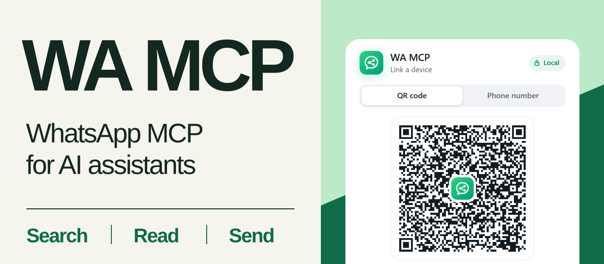
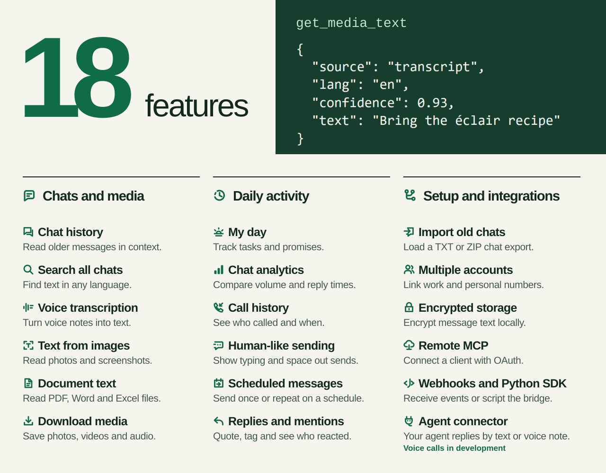
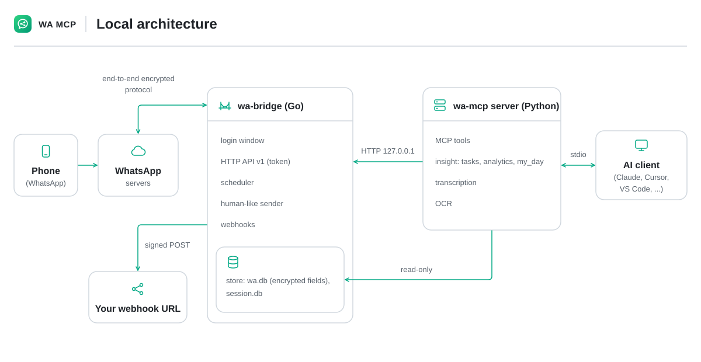

> [अंग्रेज़ी README](../../README.md) परियोजना का मूल दस्तावेज़ है। उसमें इस अनुवाद से नए बदलाव हो सकते हैं।

<p align="center">
  <picture>
    <source media="(prefers-color-scheme: dark)" srcset="../../assets/brand/banner-dark.svg">
    
  </picture>
</p>

<p align="center">
  <a href="../../LICENSE"></a>
  
  
  
  
  <a href="../../CHANGELOG.md"></a>
</p>

<p align="center">
  इस लोकल ब्रिज और MCP सर्वर से WhatsApp को अपने AI असिस्टेंट से जोड़ें। Claude, Cursor, VS Code और दूसरे MCP क्लाइंट से WhatsApp मैसेज खोजें, पढ़ें और भेजें।
</p>

<p align="center">
  <a href="../getting-started.md">शुरुआत करें</a> |
  <a href="../tutorials/README.md">ट्यूटोरियल</a> |
  <a href="../guides/configuration.md">कॉन्फ़िगरेशन</a> |
  <a href="../reference/tools.md">टूल</a> |
  <a href="../reference/http-api.md">HTTP API</a> |
  <a href="../security.md">सुरक्षा</a> |
  <a href="../faq.md">आम सवाल</a>
</p>

## फ़ोन के बिना आज़माएँ

अगर uv इंस्टॉल है, तो `uvx wa-mcp-server --demo` से आठ काल्पनिक चैट खुल जाती हैं। इसके लिए WA MCP का संस्करण 0.2.0 या बाद का संस्करण चाहिए। इंस्टॉल करने के बाद डेमो बिना इंटरनेट और बिना Go ब्रिज के चलता है।

[](https://cursor.com/install-mcp?name=wa-mcp-demo&config=eyJjb21tYW5kIjoidXZ4IiwiYXJncyI6WyJ3YS1tY3Atc2VydmVyIiwiLS1kZW1vIl19)
[](https://vscode.dev/redirect?url=vscode%3Amcp%2Finstall%3F%257B%2522name%2522%253A%2522wa-mcp-demo%2522%252C%2522type%2522%253A%2522stdio%2522%252C%2522command%2522%253A%2522uvx%2522%252C%2522args%2522%253A%255B%2522wa-mcp-server%2522%252C%2522--demo%2522%255D%257D)

**Claude Code**

```sh
claude mcp add wa-mcp-demo -- uvx wa-mcp-server --demo
```

**Claude Desktop (`claude_desktop_config.json`) और Cursor (`.cursor/mcp.json`)**

```json
{
  "mcpServers": {
    "wa-mcp-demo": { "command": "uvx", "args": ["wa-mcp-server", "--demo"] }
  }
}
```

**VS Code (`.vscode/mcp.json`)**

```json
{
  "servers": {
    "wa-mcp-demo": { "type": "stdio", "command": "uvx", "args": ["wa-mcp-server", "--demo"] }
  }
}
```

पूछें “आज मुझे कौन से काम करने हैं?” फिर “blue umbrella” खोजें और मिले हुए वॉइस नोट का ट्रांसक्रिप्ट पढ़ें। [दो मिनट का ट्यूटोरियल](../tutorials/00-demo.md)

## सुविधाएँ

<p align="center">
  <picture>
    <source media="(prefers-color-scheme: dark) and (max-width: 600px)" srcset="../../assets/features/features-dark-mobile.svg">
    <source media="(max-width: 600px)" srcset="../../assets/features/features-light-mobile.svg">
    <source media="(prefers-color-scheme: dark)" srcset="../../assets/features/features-dark.svg">
    
  </picture>
</p>

| सुविधा | यह कैसे काम करती है |
| --- | --- |
| लॉगिन विंडो | एक छोटी लोकल विंडो में QR कोड स्कैन करके या अपने फ़ोन नंबर के लिए पेयरिंग कोड लेकर अकाउंट लिंक करें। ज़रूरत पड़ने पर टर्मिनल में दिख रहा QR कोड भी इस्तेमाल कर सकते हैं। |
| एक से ज़्यादा अकाउंट | एक MCP सर्वर से कई WhatsApp नंबर जोड़ सकते हैं। हर नंबर का अपना ब्रिज, स्टोरेज और भेजने की सीमा होती है। `wa-bridge run-all` सभी ब्रिज चालू रखता है। हर टूल `account` आर्ग्युमेंट लेता है और `my_day` सभी नंबरों का हाल बताता है। जिस कॉन्फ़िगरेशन में अकाउंट की सूची नहीं है, वह पहले की तरह काम करता है। [कई अकाउंट जोड़ने की गाइड](../guides/accounts.md) देखें। |
| चैट हिस्ट्री | ब्रिज नए मैसेज और लिंक करने के बाद फ़ोन से आई हिस्ट्री सेव करता है। मैसेज में बदलाव, डिलीट किए गए मैसेज और रिएक्शन भी अपडेट होते हैं। टूल किसी एक चैट या पूरे संग्रह के लिए फ़ोन से और पुराने मैसेज मँगा सकते हैं। |
| चैट इम्पोर्ट | WhatsApp के “Export chat” विकल्प से मिली `.txt` फ़ाइल या मीडिया वाली `.zip` फ़ाइल इम्पोर्ट करें। इससे वे पुराने मैसेज भी मिल जाते हैं जिन्हें फ़ोन अब सिंक नहीं करता। इम्पोर्टर Android और iPhone के कई तारीख और समय फ़ॉर्मैट पढ़ता है और तारीख में दिन, महीने और साल का क्रम पहचानता है। पहले से सेव मैसेज छोड़ दिए जाते हैं, इसलिए इम्पोर्ट दोबारा चला सकते हैं। पहले dry run करके देखें। |
| मीडिया | इमेज, वीडियो, ऑडियो, वॉइस नोट, दस्तावेज़ और स्टिकर डाउनलोड करें। अगर WhatsApp पर फ़ाइल की कॉपी उपलब्ध नहीं रही, तो ब्रिज फ़ोन से उसे दोबारा अपलोड करने को कहता है। |
| खोज | मैसेज, ट्रांसक्रिप्ट और फ़ाइलों से निकाले गए टेक्स्ट में किसी भी लिपि में खोजें। खोज बड़े और छोटे अक्षरों में फ़र्क़ नहीं करती। एक ही व्यक्ति के फ़ोन नंबर और LID वाली चैट को साथ दिखाया जाता है। |
| वॉइस ट्रांसक्रिप्शन | वॉइस नोट को टेक्स्ट में बदलने के लिए faster-whisper, openai-whisper, whisper.cpp, OpenAI के साथ संगत कोई endpoint या अपनी कमांड इस्तेमाल करें। |
| स्क्रीनशॉट से टेक्स्ट | लोकल OCR इंजन (tesseract या RapidOCR) फ़ोटो और स्क्रीनशॉट से टेक्स्ट पढ़ता है। टेक्स्ट मैसेज के साथ सेव होता है और खोज के नतीजों तथा `list_messages` में मिलता है। |
| दस्तावेज़ और आर्काइव | PDF, DOCX, XLSX, PPTX, सादा टेक्स्ट और HTML फ़ाइलों से टेक्स्ट पढ़ें। ZIP और RAR खोले बिना उनके अंदर की फ़ाइलों की सूची देखें और सार्वजनिक Google Docs लिंक पढ़ें। |
| चैट के आँकड़े | आठ चैट तक की तुलना करें। देखें कि कितने मैसेज आए, दोनों तरफ़ से जवाब देने में कितना समय लगा, मैसेज कितने लंबे थे, इमोजी, स्टिकर और वॉइस नोट कितने इस्तेमाल हुए, बातचीत कितनी औपचारिक थी और ग्रुप में किसकी क्या भूमिका थी। |
| कामों की सूची | टूल सीधे नियमों से चैट में किए गए अनुरोध पहचानता है, उनकी स्थिति पर नज़र रखता है और आपके चुने हुए शब्द ढूँढ़ता है। इसके लिए भाषा मॉडल की ज़रूरत नहीं होती। |
| `my_day` | एक कॉल में देखें कि आज किन चीज़ों पर ध्यान देना है: खुले अनुरोध, आज पूरे करने वाले आपके वादे, जवाब का इंतज़ार कर रही चैट, मिस्ड कॉल और भेजने के लिए शेड्यूल किए गए मैसेज। |
| मैसेज भेजना | टेक्स्ट, फ़ाइलें, वॉइस नोट और स्टिकर भेजें। जवाब और मेंशन भी भेज सकते हैं। डिफ़ॉल्ट रूप से भेजना बंद रहता है। अगर क्लाइंट आपसे पुष्टि ले सकता है, तो आप हर बार भेजने की अनुमति देते हैं। अन्य क्लाइंट के लिए `sending.allow_confirm_flag` सेट करना होता है। |
| भेजने की रफ़्तार | ब्रिज पहले चैट को पढ़ा हुआ मार्क करता है। फिर मैसेज की लंबाई के हिसाब से कुछ देर टाइपिंग इंडिकेटर दिखाता है और अगला मैसेज भेजने से पहले रुकता है। वह तय शांत घंटों और प्रति घंटे की सीमा का भी पालन करता है। इससे अपने आप भेजे गए मैसेज की रफ़्तार इंसान के टाइप करने जैसी लगती है, लेकिन इसकी कोई गारंटी नहीं है। |
| रीड रिसीट | कहने पर मैसेज को पढ़ा हुआ मार्क करें या सेटिंग चालू करें ताकि यह अपने आप हो। |
| कॉल | हिस्ट्री में देखें कि कॉल किसने की, क्या वह वीडियो कॉल थी, उसका नतीजा क्या रहा और वह कितनी देर चली। एजेंट से कॉल करने और उठाने की सुविधा पर काम चल रहा है। [Roadmap](#roadmap) देखें। |
| शेड्यूल किए गए मैसेज | ब्रिज एक बार, रोज़, हर हफ़्ते या हर महीने मैसेज भेज सकता है। इसके लिए असिस्टेंट चालू रखना ज़रूरी नहीं है। |
| [एजेंट कनेक्टर](../guides/agent-connector.md) | जवाब देने के लिए अपनी API या अपना मॉडल जोड़ें। चुनी हुई चैट के लिए टेक्स्ट और वॉइस नोट का ड्राफ़्ट बनाएँ, उसे मंज़ूरी दें या भेजें। |
| Webhooks | ब्रिज आपके URL पर मैसेज, रिसीट, कॉल, कनेक्शन, शेड्यूल किए गए मैसेज और सुरक्षा से जुड़े इवेंट भेजता है। डिलीवरी विफल होने पर वह फिर कोशिश करता है। सीक्रेट सेट हो तो हर अनुरोध पर हस्ताक्षर भी करता है। |
| HTTP API | टोकन से प्रमाणीकरण करने वाली लोकल REST API, जिसकी स्पेसिफ़िकेशन OpenAPI 3.1 में उपलब्ध है। |
| दूसरे प्रोग्राम में इस्तेमाल | Go का `bridge/pkg/wabridge` पैकेज ब्रिज को दूसरे प्रोग्राम के अंदर चलाता है। इसमें सेव होने वाले हर मैसेज और चैट के लिए hooks, अतिरिक्त HTTP रूट और मैसेज भेजने, मीडिया लेने तथा हिस्ट्री पढ़ने की सुविधा है। `wa_mcp_server.embed.register` से चुने हुए टूल किसी दूसरे MCP सर्वर में जोड़ सकते हैं। |
| रिमोट एक्सेस | `wa-mcp serve --http` से claude.ai के कस्टम कनेक्टर, Claude Code, Cursor और VS Code जैसे रिमोट क्लाइंट Streamable HTTP पर MCP इस्तेमाल कर सकते हैं। हर डिवाइस के लिए अलग bearer token रख सकते हैं, जिसका सिर्फ़ हैश सेव होता है। दूसरा विकल्प OAuth 2.1 है, जिसमें PKCE, डायनेमिक रजिस्ट्रेशन और मालिक की मंज़ूरी के लिए एक पेज है। अनुरोधों की संख्या सीमित है, Host और Origin जाँचे जाते हैं, CORS डिफ़ॉल्ट रूप से बंद है और TLS प्रॉक्सी का समर्थन है। [रिमोट कनेक्शन की गाइड](../guides/remote-clients.md) देखें। |
| सर्वर पर डिप्लॉयमेंट | ब्रिज और सर्वर की Docker इमेज बिना root के चलती हैं, इनका फ़ाइल सिस्टम केवल पढ़ने के लिए है और इनमें हेल्थ चेक हैं। Compose फ़ाइल में अपने आप HTTPS सेट करने के लिए Caddy का विकल्प है। प्रॉक्सी से भी एक बार इस्तेमाल होने वाले लिंक से लॉगिन पेज खुलता है। [सर्वर पर चलाने की गाइड](../guides/server.md) देखें। किसी वास्तविक Docker होस्ट पर अभी इन इमेज का बिल्ड नहीं किया गया है। `main` पर हर push के बाद CI इमेज बिल्ड करता है और प्रीव्यू स्टैक चलाता है। |
| वैकल्पिक AI प्रोवाइडर | डिफ़ॉल्ट रूप से विश्लेषण आपका असिस्टेंट करता है। `my_day` के सारांश और इमेज के विवरण के लिए आप बैकग्राउंड में एक प्रोवाइडर सेट कर सकते हैं: Ollama, OpenAI के साथ संगत कोई सर्वर या Anthropic। API कुंजियाँ एनवायरनमेंट वेरिएबल से ली जाती हैं। खर्च सीमित रखने के लिए रोज़ाना कॉल और इनपुट की सीमा तय है। |
| Python SDK | `wa_mcp` पैकेज में ब्रिज क्लाइंट, लोकल डेटाबेस पढ़ने, ट्रांसक्रिप्शन और डेटा एक्सपोर्ट करने की सुविधाएँ हैं। |
| एन्क्रिप्शन | डेटाबेस में मैसेज का टेक्स्ट, अटैचमेंट के नाम, रिएक्शन, ट्रांसक्रिप्ट और मीडिया कुंजियाँ डिफ़ॉल्ट रूप से एन्क्रिप्टेड रहती हैं। कुंजी ऑपरेटिंग सिस्टम के कीस्टोर (Windows DPAPI, macOS Keychain या Linux Secret Service) में रखी जाती है। आप पासफ़्रेज़ या कुंजी फ़ाइल भी इस्तेमाल कर सकते हैं। API टोकन भी इसी तरह रखा जाता है। Windows पर स्टोरेज फ़ोल्डर के लिए EFS भी चालू होता है। [एन्क्रिप्शन और कुंजियों की गाइड](../guides/encryption.md) देखें। |
| सेशन अलर्ट | दूर से लॉगआउट होने, दूसरे क्लाइंट के इसी सेशन को इस्तेमाल करने, अकाउंट में नया डिवाइस जुड़ने या लॉगिन पर अलग अकाउंट मिलने की जानकारी दर्ज होती है। ये इवेंट `bridge_status`, `GET /api/v1/status` और `security` webhook में दिखते हैं। |

## दूसरे प्रोजेक्ट से तुलना

तालिका में हर प्रोजेक्ट की अपनी सुविधाएँ दी गई हैं। एन्क्रिप्शन का मतलब है कि ऐप ख़ुद मैसेज का टेक्स्ट एन्क्रिप्ट करता है। चैट इम्पोर्ट का मतलब है WhatsApp से एक्सपोर्ट की गई चैट पढ़ना। कई अकाउंट का समर्थन होने पर एक ही डिप्लॉयमेंट में एक से ज़्यादा नंबर लिंक किए जा सकते हैं। “आंशिक” का मतलब है कि सुविधा सीमित है या उसकी पुष्टि अभी नहीं हुई है।

| सुविधा | WA MCP | [finereli](https://github.com/finereli/whatsapp-mcp) | [verygoodplugins](https://github.com/verygoodplugins/whatsapp-mcp) | [felipeadeildo](https://github.com/felipeadeildo/whatsapp-mcp) | [jlucaso1](https://github.com/jlucaso1/whatsapp-mcp-ts) | [BrOrlandi](https://github.com/BrOrlandi/whatsapp-mcp-server) |
| --- | --- | --- | --- | --- | --- | --- |
| मैसेज भेजना | हाँ | नहीं | हाँ | हाँ | हाँ | हाँ |
| मीडिया और वॉइस नोट भेजना | हाँ | नहीं | हाँ | नहीं | नहीं | आंशिक |
| वॉइस ट्रांसक्रिप्शन | हाँ | हाँ | हाँ | हाँ | नहीं | हाँ |
| इमेज से टेक्स्ट (OCR) | हाँ | नहीं | नहीं | हाँ | नहीं | नहीं |
| दस्तावेज़ों से टेक्स्ट | हाँ | आंशिक | नहीं | हाँ | नहीं | नहीं |
| सेव किए गए डेटा का एन्क्रिप्शन | हाँ | हाँ | नहीं | नहीं | नहीं | नहीं |
| भेजने की रफ़्तार और सीमाएँ | हाँ | नहीं | आंशिक | आंशिक | नहीं | आंशिक |
| शेड्यूल किए गए मैसेज | हाँ | नहीं | नहीं | नहीं | नहीं | नहीं |
| एक से ज़्यादा अकाउंट | हाँ | हाँ | नहीं | हाँ | नहीं | हाँ |
| Webhooks | हाँ | नहीं | हाँ | हाँ | नहीं | हाँ |
| OAuth के साथ HTTP पर रिमोट MCP | हाँ | हाँ | आंशिक | हाँ | नहीं | आंशिक |
| Docker | हाँ | हाँ | नहीं | नहीं | हाँ | हाँ |
| चैट इम्पोर्ट | हाँ | नहीं | नहीं | नहीं | नहीं | नहीं |
| लाइसेंस | MIT | MIT | MIT | GPL-3.0 | ISC | MIT |
| प्रोग्रामिंग भाषा | Go, Python | TypeScript | Go, Python | TypeScript | TypeScript | Go |

यह तुलना नवंबर 2026 में हर प्रोजेक्ट की सार्वजनिक रिपॉज़िटरी देखकर की गई थी। कोई जानकारी ग़लत हो तो सुधार का सुझाव दें।

## आर्किटेक्चर

<p align="center">
  <picture>
    <source media="(prefers-color-scheme: dark)" srcset="../../assets/diagrams/architecture-dark.svg">
    
  </picture>
</p>

## शुरुआत करें

आपको Go 1.26 या उसके बाद का वर्शन, [uv](https://docs.astral.sh/uv/) और WhatsApp वाला फ़ोन चाहिए। `wa-bridge` (Go) लोकल डेटाबेस और API संभालता है। `wa-mcp` (Python) वह MCP सर्वर है जो डेटाबेस पढ़ता है और API को कॉल करता है।

```bash
git clone https://github.com/tsahospital-beep/wa-mcp.git
cd wa-mcp
go build -C bridge -o ../wa-bridge ./cmd/wa-bridge    # on Windows use ../wa-bridge.exe
./wa-bridge                                           # opens the login window
uv sync                                               # in a second terminal
```

लॉगिन विंडो में दिख रहा QR कोड WhatsApp से स्कैन करें। फ़ोन पर मेन्यू या सेटिंग्स खोलें, “Linked devices” चुनें और फिर “Link a device” पर टैप करें। “Connected” दिखने के बाद विंडो अपने आप बंद हो जाती है और ब्रिज चलता रहता है। फ़ोन नंबर से पेयर करने समेत पूरी प्रक्रिया [शुरुआती सेटअप की गाइड](../getting-started.md) में दी गई है।

## AI क्लाइंट जोड़ें

सर्वर stdio पर MCP इस्तेमाल करता है, इसलिए कोई भी MCP क्लाइंट इसे शुरू कर सकता है। Claude Desktop, Cursor या Windsurf के लिए नीचे दिया ब्लॉक क्लाइंट की MCP कॉन्फ़िगरेशन फ़ाइल में जोड़ें। फ़ाइल कहाँ मिलेगी, यह [MCP क्लाइंट जोड़ने की गाइड](../guides/mcp-clients.md) में देखें। `REPOSITORY_DIRECTORY` और `CONFIG_FILE` की जगह रिपॉज़िटरी और कॉन्फ़िगरेशन फ़ाइल के पूरे पाथ लिखें।

```json
{
  "mcpServers": {
    "wa-mcp": {
      "command": "uv",
      "args": [
        "run", "--directory", "REPOSITORY_DIRECTORY",
        "wa-mcp", "--config", "CONFIG_FILE"
      ]
    }
  }
}
```

Claude Code में:

```bash
claude mcp add wa-mcp -- uv run --directory "REPOSITORY_DIRECTORY" wa-mcp --config "CONFIG_FILE"
```

VS Code में `.vscode/mcp.json` फ़ाइल में:

```json
{
  "servers": {
    "wa-mcp": {
      "type": "stdio",
      "command": "uv",
      "args": [
        "run", "--directory", "REPOSITORY_DIRECTORY",
        "wa-mcp", "--config", "CONFIG_FILE"
      ]
    }
  }
}
```

इसके बाद असिस्टेंट से `bridge_status` चलाने को कहें ताकि पता चले कि सेटअप सही है।

## ट्यूटोरियल

[ट्यूटोरियल की सूची](../tutorials/README.md) में इंस्टॉलेशन, पहला लॉगिन, क्लाइंट, टास्क, वॉइस नोट, स्क्रीनशॉट, इम्पोर्ट, मैसेज भेजने, कई अकाउंट, Docker, रिमोट एक्सेस, webhooks और सुरक्षा के लिए चरण-दर-चरण निर्देश हैं।

## उदाहरण: “आज मुझे कौन से काम करने हैं?”

```text
You:        What are my tasks today?

Assistant:  (calls my_day for 2026-11-23)

            Four things need you today.

            A client asked for the updated invoice yesterday at 16:40 and wants it by the end of the
            day. It is still open.

            On Sunday you told a colleague "I will send you the photos tomorrow". That promise is due today.

            The Book club group asked "Which day works for the next meeting?" about 95 minutes ago.
            Nobody has answered yet.

            A reminder for the Book club is scheduled to go out at 18:00.
```

`my_day` आपकी मशीन पर चलता है और सीधे नियमों से काम पहचानता है। असिस्टेंट बस नतीजे को शब्दों में पेश करता है।

## कॉन्फ़िगरेशन

ब्रिज और सर्वर बिना कॉन्फ़िगरेशन फ़ाइल के भी चलते हैं। सेटिंग बदलने के लिए [`config.example.json`](../../config.example.json) की कॉपी `config.json` नाम से बनाएँ। उदाहरण फ़ाइल में हर कुंजी और उसका डिफ़ॉल्ट मान दिया है। `WA_MCP_API_LISTEN` जैसे एनवायरनमेंट वेरिएबल से भी सेटिंग दी जा सकती है। कोई अनजान कुंजी मिले तो ब्रिज चेतावनी देता है। उदाहरण के लिए, मैसेज भेजने की अनुमति देने और ट्रांसक्रिप्शन के लिए छोटा मॉडल चुनने की सेटिंग इस तरह है:

```json
{
  "sending": { "enabled": true },
  "transcription": { "model": "small" }
}
```

सभी कुंजियों का विवरण [कॉन्फ़िगरेशन गाइड](../guides/configuration.md) में है। भेजने से जुड़ी सेटिंग के लिए [मैसेज भेजने की गाइड](../guides/sending.md) देखें।

## वॉइस ट्रांसक्रिप्शन

ट्रांसक्रिप्शन वैकल्पिक है। बैकएंड चुनने के लिए `transcription.backend` सेट करें।

| बैकएंड | विवरण |
| --- | --- |
| `faster-whisper` | डिफ़ॉल्ट विकल्प। CPU या NVIDIA GPU पर चलता है। |
| `openai-whisper` | PyTorch में बना रेफ़रेंस इम्प्लीमेंटेशन। |
| `whisper.cpp` | अलग `whisper-cli` प्रोग्राम और ggml मॉडल इस्तेमाल करता है। |
| `http` | OpenAI के साथ संगत कोई भी सर्वर जो `/v1/audio/transcriptions` उपलब्ध कराता हो। |
| `command` | कोई भी प्रोग्राम जो WAV फ़ाइल लेकर उसका टेक्स्ट प्रिंट करे। |

ffmpeg आपके `PATH` में होना चाहिए। बैकएंड इंस्टॉल करने के लिए अपने सिस्टम की स्क्रिप्ट चलाएँ:

```bash
scripts/install_whisper.sh --backend faster-whisper --model large-v3 --download
```

```powershell
scripts\install_whisper.ps1 -Backend faster-whisper -Model large-v3 -Download
```

विस्तृत निर्देश और `uv sync` चलाने के बाद भी पैकेज इंस्टॉल रखने का तरीका [वॉइस ट्रांसक्रिप्शन गाइड](../guides/transcription.md) में देखें।

## अपने प्रोजेक्ट में इस्तेमाल करें

Python से लोकल डेटाबेस पढ़ने का उदाहरण:

```python
from wa_mcp import config, db, people

cfg = config.load("config.json")
db.connect(cfg)
people.connect(cfg)

for m in db.messages(after="2026-11-01", query="invoice", limit=5):
    print(m["time"], people.name_of(m["conv"]), m["body"][:60])
```

हस्ताक्षर वाले webhook की जाँच के लिए अनुरोध की मूल बॉडी और वे दोनों हेडर इस्तेमाल करें जिन्हें ब्रिज ने हस्ताक्षर में शामिल किया था।

```python
import hashlib, hmac, json, os, time
from http.server import BaseHTTPRequestHandler, HTTPServer

SECRET = os.environ["WA_MCP_WEBHOOK_SECRET"].encode()


class Hook(BaseHTTPRequestHandler):
    def do_POST(self):
        body = self.rfile.read(int(self.headers.get("Content-Length", 0)))
        stamp = self.headers.get("X-WA-MCP-Timestamp", "")
        delivery = self.headers.get("X-WA-MCP-Delivery", "")
        signed = f"{stamp}.{delivery}.".encode() + body
        expected = "sha256=" + hmac.new(SECRET, signed, hashlib.sha256).hexdigest()
        valid_stamp = stamp.isascii() and stamp.isdecimal() and len(stamp) <= 12
        fresh = valid_stamp and abs(time.time() - int(stamp)) <= 300
        if not (
            fresh and delivery and hmac.compare_digest(expected, self.headers.get("X-WA-MCP-Signature", ""))
        ):
            self.send_response(401)
            self.end_headers()
            return
        print(json.loads(body)["event"])
        self.send_response(204)
        self.end_headers()


HTTPServer(("127.0.0.1", 9000), Hook).serve_forever()
```

दोबारा डिलीवरी की कोशिश पर वही ID मिलती है। पहले से प्रोसेस हो चुकी ID को छोड़ने वाले रिसीवर का उदाहरण [webhook_receiver.py](../../examples/webhook_receiver.py) में है।

HTTP API को कॉल करने का उदाहरण:

```bash
TOKEN=$(./wa-bridge api-token)
curl -H "Authorization: Bearer $TOKEN" "http://127.0.0.1:8080/api/v1/messages?query=invoice&limit=5"
```

अधिक जानकारी के लिए [Webhooks](../guides/webhooks.md), [HTTP API रेफ़रेंस](../reference/http-api.md) और [MCP टूल की सूची](../reference/tools.md) देखें।

## सुरक्षा और निजता

- डिफ़ॉल्ट रूप से ब्रिज चैट लोकल स्टोरेज में रखता है और API व लॉगिन अनुरोध सिर्फ़ लूपबैक इंटरफ़ेस पर स्वीकार करता है। आपका MCP क्लाइंट जिन टूल को कॉल करता है, उनके नतीजे उसे मिलते हैं।
- `/api/v1` के endpoints के लिए bearer token चाहिए। उसे देखने के लिए `wa-bridge api-token` चलाएँ। स्टोरेज फ़ोल्डर तक पहुँच आपके यूज़र तक सीमित है। लॉगिन लिंक सिर्फ़ एक बार काम करते हैं।
- डेटाबेस में मैसेज का टेक्स्ट डिफ़ॉल्ट रूप से एन्क्रिप्टेड रहता है। आपके यूज़र की कुंजी Windows पर DPAPI, macOS पर Keychain या Linux पर Secret Service की सुरक्षा में रहती है। इसलिए स्टोरेज की कॉपी किसी दूसरी मशीन या दूसरे Windows अकाउंट पर नहीं पढ़ी जा सकती। Windows पर WhatsApp सेशन समेत पूरा स्टोरेज फ़ोल्डर EFS से भी एन्क्रिप्ट होता है। macOS और Linux पर सेशन फ़ाइल की सुरक्षा के लिए पूरे डिस्क का एन्क्रिप्शन चालू करें।
- अगर दूसरा क्लाइंट यही सेशन इस्तेमाल करे या नया डिवाइस लिंक हो, तो ब्रिज इन इवेंट की जानकारी `bridge_status`, स्टेटस endpoint और `security` webhook में देता है।
- डिफ़ॉल्ट रूप से मैसेज भेजना बंद रहता है। अगर क्लाइंट पुष्टि माँग सकता है तो आप हर मैसेज भेजने से पहले मंज़ूरी देते हैं। बाकी क्लाइंट के लिए `sending.allow_confirm_flag` चालू करना होता है। इसके बाद वे `confirm=true` भेजते हैं। यह जाँच कमज़ोर है क्योंकि मान मॉडल ख़ुद सेट करता है। ब्रिज भेजने की सीमा और शांत घंटों का पालन करता है और डुप्लिकेट रोकता है। जब तक आप और फ़ोल्डर की अनुमति न दें, सिर्फ़ डाउनलोड और एक्सपोर्ट फ़ोल्डर से फ़ाइलें भेजी जाती हैं।
- मैसेज के टेक्स्ट को अविश्वसनीय इनपुट माना जाता है। सर्वर क्लाइंट को बताता है कि उसमें लिखे निर्देशों का पालन न करें।
- webhook के लिए सीक्रेट सेट होने पर हस्ताक्षर में टाइमस्टैम्प, डिलीवरी ID और अनुरोध की मूल बॉडी शामिल होती है। हर सत्यापित डिलीवरी ID सिर्फ़ एक बार प्रोसेस करें। दोबारा कोशिश होने पर वही ID आती है।
- रिमोट एक्सेस अलग से चालू करना पड़ता है। `wa-mcp serve --http` में `/mcp` के लिए वैध bearer token चाहिए। लूपबैक के बाहर अनुरोध लेने के लिए TLS प्रॉक्सी और `server.trusted_proxies` की सेटिंग ज़रूरी हैं, जब तक आप `--insecure-lan` इस्तेमाल न करें। [रिमोट मोड की सुरक्षा](../security/remote.md) देखें।
- एन्क्रिप्शन में मैसेज का टेक्स्ट, अटैचमेंट के नाम, रिएक्शन, ट्रांसक्रिप्ट और मीडिया कुंजियाँ शामिल हैं। डाउनलोड, एक्सपोर्ट, चैट ID, शीर्षक और टाइमस्टैम्प इस दायरे से बाहर हैं।
- एडमिन या आपके यूज़र के अधिकारों से चल रहा मैलवेयर अब भी स्टोरेज पढ़ सकता है और कीस्टोर से कुंजी माँग सकता है। समय-समय पर फ़ोन में “Linked devices” की सूची देखें।

विवरण [docs/security.md](../security.md) में है। कुंजियों और एन्क्रिप्शन मोड के लिए [एन्क्रिप्शन गाइड](../guides/encryption.md) और ख़तरों के मॉडल के लिए [docs/security/audit.md](../security/audit.md) देखें। किसी सुरक्षा खामी की सूचना देने के लिए [SECURITY.md](../../SECURITY.md) पढ़ें।

## Roadmap

- **वॉइस कॉल (काम जारी है)।** एजेंट WhatsApp पर एक व्यक्ति को कॉल कर सकेगा और उसकी कॉल उठा सकेगा। कॉल करने वाले की आवाज़ आपके स्पीच मॉडल या वॉइस सर्विस तक जाएगी और उसका जवाब कॉल में सुनाया जाएगा। यह एक अलग मॉड्यूल में आएगा जो डिफ़ॉल्ट रूप से बंद रहेगा। इसमें मिस्ड कॉल के बाद मैसेज भेजने की सुविधा भी होगी।

## लाइसेंस

[MIT](../../LICENSE)। डिपेंडेंसी के लाइसेंस [THIRD_PARTY_NOTICES.md](../../THIRD_PARTY_NOTICES.md) में दिए गए हैं।
