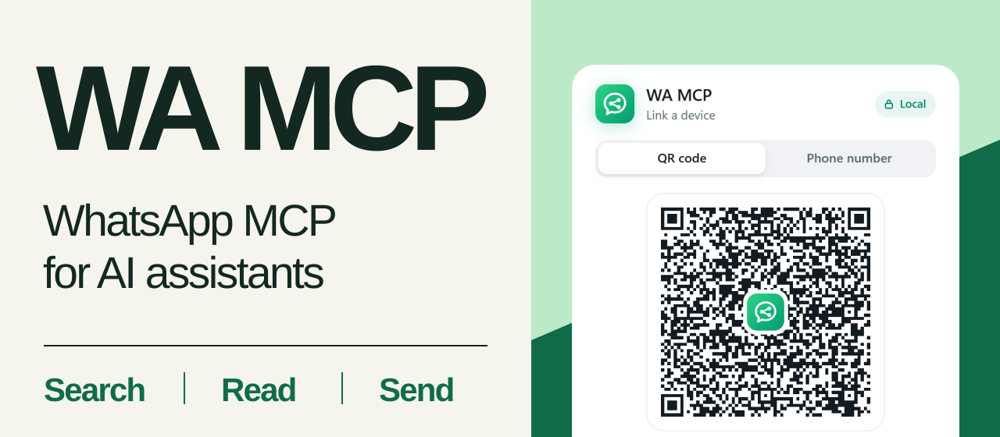
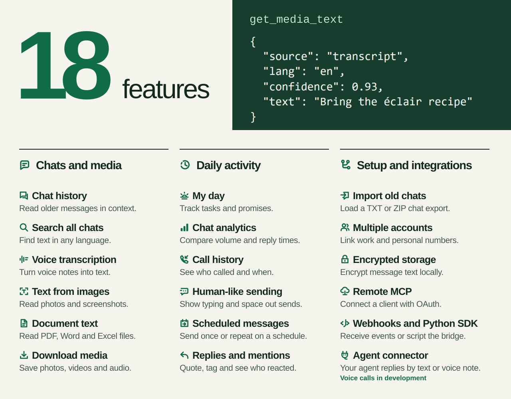
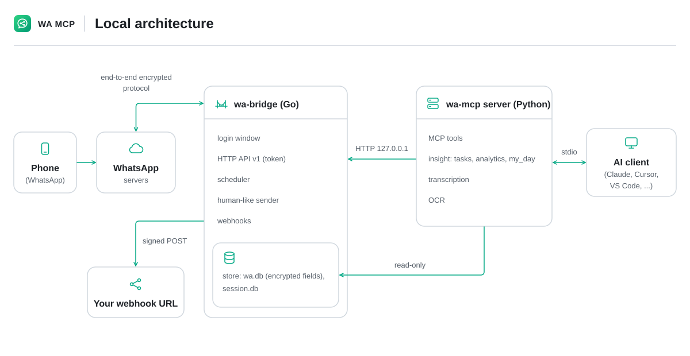

> O [README em inglês](../../README.md) é a referência do projeto e pode estar mais atualizado.

<p align="center">
  <picture>
    <source media="(prefers-color-scheme: dark)" srcset="../../assets/brand/banner-dark.svg">
    
  </picture>
</p>

<p align="center">
  <a href="../../LICENSE"></a>
  
  
  
  
  <a href="../../CHANGELOG.md"></a>
</p>

<p align="center">
  Uma ponte local e um servidor MCP conectam o WhatsApp a assistentes de IA para você buscar, ler e enviar mensagens pelo Claude, Cursor, VS Code e outros clientes MCP.
</p>

<p align="center">
  <a href="../getting-started.md">Primeiros passos</a> |
  <a href="../tutorials/README.md">Tutoriais</a> |
  <a href="../guides/configuration.md">Configuração</a> |
  <a href="../reference/tools.md">Ferramentas</a> |
  <a href="../reference/http-api.md">API HTTP</a> |
  <a href="../security.md">Segurança</a> |
  <a href="../faq.md">Perguntas frequentes</a>
</p>

## Experimente sem celular

Com o uv instalado, `uvx wa-mcp-server --demo` abre um arquivo fictício com oito conversas. A demonstração requer o WA MCP 0.2.0 ou superior. Depois da instalação, funciona sem internet e sem a ponte em Go.

[](https://cursor.com/install-mcp?name=wa-mcp-demo&config=eyJjb21tYW5kIjoidXZ4IiwiYXJncyI6WyJ3YS1tY3Atc2VydmVyIiwiLS1kZW1vIl19)
[](https://vscode.dev/redirect?url=vscode%3Amcp%2Finstall%3F%257B%2522name%2522%253A%2522wa-mcp-demo%2522%252C%2522type%2522%253A%2522stdio%2522%252C%2522command%2522%253A%2522uvx%2522%252C%2522args%2522%253A%255B%2522wa-mcp-server%2522%252C%2522--demo%2522%255D%257D)

**Claude Code**

```sh
claude mcp add wa-mcp-demo -- uvx wa-mcp-server --demo
```

**Claude Desktop (`claude_desktop_config.json`) e Cursor (`.cursor/mcp.json`)**

```json
{
  "mcpServers": {
    "wa-mcp-demo": { "command": "uvx", "args": ["wa-mcp-server", "--demo"] }
  }
}
```

**VS Code (`.vscode/mcp.json`)**

```json
{
  "servers": {
    "wa-mcp-demo": { "type": "stdio", "command": "uvx", "args": ["wa-mcp-server", "--demo"] }
  }
}
```

Pergunte “Quais são as minhas tarefas de hoje?”. Depois, procure por “blue umbrella” e leia a transcrição da mensagem de voz. [Tutorial de dois minutos](../tutorials/00-demo.md)

## Recursos

<p align="center">
  <picture>
    <source media="(prefers-color-scheme: dark) and (max-width: 600px)" srcset="../../assets/features/features-dark-mobile.svg">
    <source media="(max-width: 600px)" srcset="../../assets/features/features-light-mobile.svg">
    <source media="(prefers-color-scheme: dark)" srcset="../../assets/features/features-dark.svg">
    
  </picture>
</p>

| Área | O que faz |
| --- | --- |
| Janela de login | Vincule sua conta em uma janela local com um QR code ou um código de pareamento para o seu número. O terminal também exibe o QR code. |
| Várias contas | Use vários números do WhatsApp no mesmo servidor MCP. Cada número tem uma ponte com armazenamento e limites de envio próprios. `wa-bridge run-all` mantém as pontes em execução. Todas as ferramentas aceitam o argumento `account`, e `my_day` consulta todos os números. Configurações sem contas continuam funcionando como antes. Veja [Várias contas](../guides/accounts.md). |
| Histórico | A ponte armazena as mensagens que chegam e o histórico que o celular envia após a vinculação. Ela também aplica edições, exclusões e reações. As ferramentas podem pedir ao celular trechos mais antigos de uma conversa ou de todo o histórico. |
| Importação de conversas | Importe um arquivo gerado pela opção “Exportar conversa” do WhatsApp (`.txt` ou `.zip` com mídia) para recuperar mensagens anteriores ao período sincronizado pelo celular. A importação reconhece arquivos do Android e do iPhone, aceita vários formatos de data e hora e detecta a ordem dos componentes da data. Você pode repetir a importação, pois ela ignora mensagens já armazenadas. Faça uma simulação primeiro. |
| Mídia | Baixe imagens, vídeos, áudios, mensagens de voz, documentos e figurinhas. Se a cópia do WhatsApp tiver expirado, a ponte pede ao celular que envie o arquivo novamente. |
| Busca | Pesquise mensagens, transcrições e texto extraído de arquivos em qualquer sistema de escrita, sem diferenciar maiúsculas de minúsculas. A busca reúne as conversas da mesma pessoa identificadas pelo telefone e pelo LID. |
| Transcrição de voz | Converta mensagens de voz em texto com faster-whisper, openai-whisper, whisper.cpp, um endpoint compatível com OpenAI ou um comando próprio. |
| Texto em capturas de tela | Um mecanismo de OCR local (tesseract ou RapidOCR) lê o texto de fotos e capturas de tela. O texto fica junto à mensagem e aparece na busca e em `list_messages`. |
| Documentos e arquivos compactados | Extraia texto de arquivos PDF, DOCX, XLSX, PPTX, de texto simples e HTML. Consulte o conteúdo de arquivos ZIP e RAR sem descompactá-los e leia documentos públicos por links do Google Docs. |
| Análise de conversas | Compare até oito conversas por volume e tamanho das mensagens, tempo de resposta de cada lado, uso de emojis, figurinhas e mensagens de voz, grau de formalidade e papéis no grupo. |
| Tarefas | Regras simples identificam pedidos nas conversas, acompanham seu status e localizam palavras que você escolheu monitorar. O recurso dispensa modelos de linguagem. |
| `my_day` | Uma chamada lista os pedidos em aberto, os compromissos que você assumiu e vencem hoje, as conversas que aguardam sua resposta, as chamadas perdidas e os envios agendados. |
| Envio | Envie texto, arquivos, mensagens de voz e figurinhas, com respostas e menções. O envio vem desativado. Você aprova cada envio nos clientes que permitem confirmação. Nos demais, é preciso habilitar `sending.allow_confirm_flag`. |
| Ritmo de envio | A ponte marca a conversa como lida, mostra o indicador de digitação por um tempo proporcional ao tamanho da mensagem e faz uma pausa entre os envios. Respeita os horários de silêncio e os limites por hora. Isso dá um ritmo mais natural aos envios automáticos, mas não oferece garantias. |
| Confirmações de leitura | Marque mensagens como lidas sob demanda ou ative a marcação automática. |
| Chamadas | Consulte o histórico com o sentido da chamada, se foi por vídeo, o resultado e a duração. O recurso para fazer e atender chamadas com um agente está em desenvolvimento. Veja os [planos](#planos). |
| Mensagens agendadas | A ponte envia mensagens uma única vez ou com frequência diária, semanal ou mensal, mesmo com o assistente desligado. |
| [Conector de agentes](../guides/agent-connector.md) | Conecte seu modelo ou sua API de respostas. Prepare, aprove ou envie mensagens de texto e de voz nas conversas autorizadas. |
| Webhooks | A ponte publica eventos de mensagens, leitura e entrega, chamadas, conexão, agendamentos e segurança nas suas URLs. Ela repete as entregas que falham e assina as requisições quando há um segredo configurado. |
| API HTTP | API REST local com autenticação por token e documentação OpenAPI 3.1. |
| Integração em outros programas | O pacote Go `bridge/pkg/wabridge` executa a ponte dentro de outro programa, com hooks para cada mensagem e conversa armazenada, rotas HTTP adicionais e acesso a envio, mídia e histórico. Use `wa_mcp_server.embed.register` para registrar ferramentas específicas em outro servidor MCP. |
| Acesso remoto | `wa-mcp serve --http` disponibiliza MCP por Streamable HTTP para clientes remotos como conectores personalizados do claude.ai, Claude Code, Cursor e VS Code. Use tokens bearer por dispositivo, armazenados como hashes, ou OAuth 2.1 com PKCE, registro dinâmico e uma página de aprovação para o proprietário. Há limites de requisições, verificação de Host e Origin e suporte a proxy TLS. O CORS vem desativado. Veja [Acesso remoto](../guides/remote-clients.md). |
| Implantação em servidor | Imagens Docker para a ponte e o servidor rodam sem root, com sistema de arquivos somente leitura e verificações de integridade. O arquivo Compose oferece Caddy como opção para HTTPS automático. A página de login funciona pelo proxy com um link de uso único. Veja [Execução em servidor](../guides/server.md). As imagens ainda não foram compiladas em um host Docker real. A cada push para `main`, a CI compila as imagens e inicia o ambiente de prévia. |
| Provedores de IA (opcional) | Por padrão, o assistente faz a análise. Se quiser resumos em `my_day` e descrições de imagens, configure um provedor em segundo plano: Ollama, um servidor compatível com OpenAI ou Anthropic. As chaves vêm de variáveis de ambiente. Limites diários de chamadas e de entrada ajudam a controlar os custos. |
| SDK Python | O pacote `wa_mcp` oferece um cliente para a ponte, leitura do banco de dados local, transcrição e exportação. |
| Criptografia | Ativada por padrão para o texto das mensagens, nomes de anexos, reações, transcrições e chaves de mídia no banco de dados. A chave fica no cofre do sistema (Windows DPAPI, macOS Keychain ou Linux Secret Service). Também é possível usar uma frase secreta ou um arquivo de chave. O token da API tem a mesma proteção. No Windows, a pasta de armazenamento usa EFS. Veja [Criptografia e chaves](../guides/encryption.md). |
| Alertas de sessão | A ponte registra quando a sessão é encerrada remotamente, outro cliente usa a mesma sessão, um novo dispositivo é vinculado ou o login é feito com outra conta. Os alertas aparecem em `bridge_status`, em `GET /api/v1/status` e no webhook `security`. |

## Comparação com outros projetos

A tabela mostra os recursos oferecidos por cada projeto. Criptografia indica que a aplicação cifra o texto das mensagens. Importação de conversas significa ler uma conversa exportada pelo WhatsApp. Várias contas indica que uma única instalação aceita mais de um número vinculado. “Parcial” indica suporte limitado ou ainda sem confirmação.

| Recurso | WA MCP | [finereli](https://github.com/finereli/whatsapp-mcp) | [verygoodplugins](https://github.com/verygoodplugins/whatsapp-mcp) | [felipeadeildo](https://github.com/felipeadeildo/whatsapp-mcp) | [jlucaso1](https://github.com/jlucaso1/whatsapp-mcp-ts) | [BrOrlandi](https://github.com/BrOrlandi/whatsapp-mcp-server) |
| --- | --- | --- | --- | --- | --- | --- |
| Enviar mensagens | Sim | Não | Sim | Sim | Sim | Sim |
| Enviar mídia e mensagens de voz | Sim | Não | Sim | Não | Não | Parcial |
| Transcrição de voz | Sim | Sim | Sim | Sim | Não | Sim |
| Texto em imagens (OCR) | Sim | Não | Não | Sim | Não | Não |
| Texto de documentos | Sim | Parcial | Não | Sim | Não | Não |
| Criptografia em repouso | Sim | Sim | Não | Não | Não | Não |
| Ritmo de envio e limites | Sim | Não | Parcial | Parcial | Não | Parcial |
| Mensagens agendadas | Sim | Não | Não | Não | Não | Não |
| Várias contas | Sim | Sim | Não | Sim | Não | Sim |
| Webhooks | Sim | Não | Sim | Sim | Não | Sim |
| MCP remoto por HTTP com OAuth | Sim | Sim | Parcial | Sim | Não | Parcial |
| Docker | Sim | Sim | Não | Não | Sim | Sim |
| Importação de conversas | Sim | Não | Não | Não | Não | Não |
| Licença | MIT | MIT | MIT | GPL-3.0 | ISC | MIT |
| Linguagem | Go, Python | TypeScript | Go, Python | TypeScript | TypeScript | Go |

A comparação foi feita em novembro de 2026 com base nos repositórios públicos dos projetos. Correções são bem-vindas.

## Arquitetura

<p align="center">
  <picture>
    <source media="(prefers-color-scheme: dark)" srcset="../../assets/diagrams/architecture-dark.svg">
    
  </picture>
</p>

## Início rápido

Você precisa do Go 1.26 ou superior, do [uv](https://docs.astral.sh/uv/) e de um celular com WhatsApp. O `wa-bridge` (Go) mantém um banco de dados local e uma API. O `wa-mcp` (Python) é o servidor MCP que lê o banco e chama a API.

```bash
git clone https://github.com/tsahospital-beep/wa-mcp.git
cd wa-mcp
go build -C bridge -o ../wa-bridge ./cmd/wa-bridge    # on Windows use ../wa-bridge.exe
./wa-bridge                                           # opens the login window
uv sync                                               # in a second terminal
```

Na janela de login, escaneie o QR code pelo WhatsApp. Abra o menu ou as configurações, escolha “Dispositivos conectados” e toque em “Conectar um dispositivo”. Quando aparecer “Connected”, a janela se fecha e a ponte continua em execução. Veja o passo a passo completo, inclusive como parear pelo número de telefone, em [Primeiros passos](../getting-started.md).

## Conectar um cliente de IA

O servidor usa MCP por stdio, então qualquer cliente MCP pode iniciá-lo. No Claude Desktop, Cursor ou Windsurf, adicione o trecho abaixo ao arquivo de configuração MCP do cliente. Consulte os locais desses arquivos em [Conectar um cliente MCP](../guides/mcp-clients.md). Substitua `REPOSITORY_DIRECTORY` e `CONFIG_FILE` pelos respectivos caminhos absolutos.

```json
{
  "mcpServers": {
    "wa-mcp": {
      "command": "uv",
      "args": [
        "run", "--directory", "REPOSITORY_DIRECTORY",
        "wa-mcp", "--config", "CONFIG_FILE"
      ]
    }
  }
}
```

No Claude Code:

```bash
claude mcp add wa-mcp -- uv run --directory "REPOSITORY_DIRECTORY" wa-mcp --config "CONFIG_FILE"
```

No VS Code, em `.vscode/mcp.json`:

```json
{
  "servers": {
    "wa-mcp": {
      "type": "stdio",
      "command": "uv",
      "args": [
        "run", "--directory", "REPOSITORY_DIRECTORY",
        "wa-mcp", "--config", "CONFIG_FILE"
      ]
    }
  }
}
```

Depois, peça ao assistente que execute `bridge_status` para verificar a configuração.

## Tutoriais

O [índice de tutoriais](../tutorials/README.md) reúne instruções passo a passo para instalação, primeiro login, clientes, tarefas, voz, capturas de tela, importações, envio, várias contas, Docker, acesso remoto, webhooks e segurança.

## Exemplo: “Quais são as minhas tarefas de hoje?”

```text
You:        What are my tasks today?

Assistant:  (calls my_day for 2026-11-23)

            Four things need you today.

            A client asked for the updated invoice yesterday at 16:40 and wants it by the end of the
            day. It is still open.

            On Sunday you told a colleague "I will send you the photos tomorrow". That promise is due today.

            The Book club group asked "Which day works for the next meeting?" about 95 minutes ago.
            Nobody has answered yet.

            A reminder for the Book club is scheduled to go out at 18:00.
```

O `my_day` roda na sua máquina e usa regras simples. O assistente apenas apresenta o resultado em palavras.

## Configuração

A ponte e o servidor funcionam sem arquivo de configuração. Para alterar uma opção, copie [`config.example.json`](../../config.example.json) para `config.json`. O exemplo lista todas as chaves e seus valores padrão. Você também pode usar variáveis de ambiente como `WA_MCP_API_LISTEN`. A ponte avisa quando encontra chaves desconhecidas. Por exemplo, para permitir o envio e usar um modelo de transcrição menor:

```json
{
  "sending": { "enabled": true },
  "transcription": { "model": "small" }
}
```

Consulte todas as chaves em [Configuração](../guides/configuration.md). As opções de envio estão em [Envio de mensagens](../guides/sending.md).

## Transcrição de voz

A transcrição é opcional. Escolha um backend com `transcription.backend`.

| Backend | Observações |
| --- | --- |
| `faster-whisper` | Padrão. Roda na CPU ou em uma GPU NVIDIA. |
| `openai-whisper` | Implementação de referência em PyTorch. |
| `whisper.cpp` | Usa o executável `whisper-cli` e um modelo ggml. |
| `http` | Qualquer servidor compatível com a API da OpenAI que ofereça `/v1/audio/transcriptions`. |
| `command` | Qualquer programa que receba um arquivo WAV e imprima a transcrição. |

O ffmpeg precisa estar no `PATH`. Instale o backend com o script do seu sistema:

```bash
scripts/install_whisper.sh --backend faster-whisper --model large-v3 --download
```

```powershell
scripts\install_whisper.ps1 -Backend faster-whisper -Model large-v3 -Download
```

Veja os detalhes em [Transcrição de voz](../guides/transcription.md), inclusive como manter os pacotes instalados ao executar `uv sync`.

## Uso no seu projeto

Para ler o banco de dados local em Python:

```python
from wa_mcp import config, db, people

cfg = config.load("config.json")
db.connect(cfg)
people.connect(cfg)

for m in db.messages(after="2026-11-01", query="invoice", limit=5):
    print(m["time"], people.name_of(m["conv"]), m["body"][:60])
```

Para verificar a assinatura de um webhook, use o corpo bruto da requisição e os dois cabeçalhos que a ponte incluiu na assinatura.

```python
import hashlib, hmac, json, os, time
from http.server import BaseHTTPRequestHandler, HTTPServer

SECRET = os.environ["WA_MCP_WEBHOOK_SECRET"].encode()


class Hook(BaseHTTPRequestHandler):
    def do_POST(self):
        body = self.rfile.read(int(self.headers.get("Content-Length", 0)))
        stamp = self.headers.get("X-WA-MCP-Timestamp", "")
        delivery = self.headers.get("X-WA-MCP-Delivery", "")
        signed = f"{stamp}.{delivery}.".encode() + body
        expected = "sha256=" + hmac.new(SECRET, signed, hashlib.sha256).hexdigest()
        valid_stamp = stamp.isascii() and stamp.isdecimal() and len(stamp) <= 12
        fresh = valid_stamp and abs(time.time() - int(stamp)) <= 300
        if not (
            fresh and delivery and hmac.compare_digest(expected, self.headers.get("X-WA-MCP-Signature", ""))
        ):
            self.send_response(401)
            self.end_headers()
            return
        print(json.loads(body)["event"])
        self.send_response(204)
        self.end_headers()


HTTPServer(("127.0.0.1", 9000), Hook).serve_forever()
```

As novas tentativas usam o mesmo ID de entrega. O exemplo [webhook_receiver.py](../../examples/webhook_receiver.py) mostra como ignorar os IDs já processados.

Para chamar a API HTTP:

```bash
TOKEN=$(./wa-bridge api-token)
curl -H "Authorization: Bearer $TOKEN" "http://127.0.0.1:8080/api/v1/messages?query=invoice&limit=5"
```

Saiba mais em [Webhooks](../guides/webhooks.md), na [referência da API HTTP](../reference/http-api.md) e na lista de [ferramentas MCP](../reference/tools.md).

## Segurança e privacidade

- Por padrão, a ponte armazena as conversas localmente e só aceita requisições de API e de login pela interface de loopback. O cliente MCP recebe os resultados das ferramentas que solicita.
- Os endpoints de `/api/v1` exigem um token bearer. Execute `wa-bridge api-token` para consultá-lo. Só o seu usuário tem acesso à pasta de armazenamento. Os links de login são de uso único.
- O texto das mensagens no banco de dados é criptografado por padrão. A chave é protegida pelo Windows DPAPI, pelo Keychain do macOS ou pelo Secret Service do Linux para o seu usuário. Uma cópia do banco em outro computador ou em outra conta do Windows não pode ser lida. No Windows, o EFS também criptografa a pasta de armazenamento, inclusive a sessão do WhatsApp. No macOS e no Linux, use criptografia de disco inteiro para proteger o arquivo de sessão.
- A ponte informa eventos como o uso da sessão por outro cliente ou a vinculação de um novo dispositivo em `bridge_status`, no endpoint de status e no webhook `security`.
- O envio vem desativado. Se o cliente consegue pedir confirmação, você aprova cada envio. Nos demais clientes, é preciso definir `sending.allow_confirm_flag` para que eles possam passar `confirm=true`. Essa verificação é mais fraca porque o próprio modelo define o valor. A ponte impõe limites, respeita horários de silêncio e evita duplicatas. Por padrão, só envia arquivos das pastas de downloads e exportações, a menos que você permita outras.
- O texto das mensagens é uma entrada não confiável. O servidor orienta os clientes a ignorar instruções encontradas nele.
- Quando um segredo de webhook está configurado, a assinatura cobre o timestamp, o ID de entrega e o corpo bruto. Processe cada ID verificado só uma vez. O ID é o mesmo nas novas tentativas.
- O acesso remoto precisa ser ativado. `wa-mcp serve --http` exige um token bearer válido para `/mcp`. Para escutar fora da interface de loopback, é necessário um proxy TLS e a configuração de `server.trusted_proxies`, salvo se você usar `--insecure-lan`. Veja [Segurança do modo remoto](../security/remote.md).
- A criptografia abrange o texto das mensagens, nomes de anexos, reações, transcrições e chaves de mídia. Downloads, exportações, IDs e títulos de conversas e timestamps ficam fora dessa proteção.
- Um administrador ou um malware em execução com a sua conta ainda pode ler o armazenamento e solicitar a chave ao cofre do sistema. Confira de vez em quando os dispositivos conectados no WhatsApp do celular.

Consulte [docs/security.md](../security.md) para mais detalhes, [Criptografia e chaves](../guides/encryption.md) para chaves e modos de criptografia e [docs/security/audit.md](../security/audit.md) para o modelo de ameaças. Para relatar uma vulnerabilidade, veja [SECURITY.md](../../SECURITY.md).

## Planos

- **Chamadas de voz (em desenvolvimento).** O agente poderá fazer e atender chamadas individuais no WhatsApp. O áudio de quem liga será encaminhado ao seu modelo de fala ou serviço de voz, e a resposta será reproduzida na chamada. O recurso virá em um módulo separado, desativado por padrão, que também poderá enviar uma mensagem após uma chamada perdida.

## Licença

[MIT](../../LICENSE). As licenças das dependências estão em [THIRD_PARTY_NOTICES.md](../../THIRD_PARTY_NOTICES.md).
