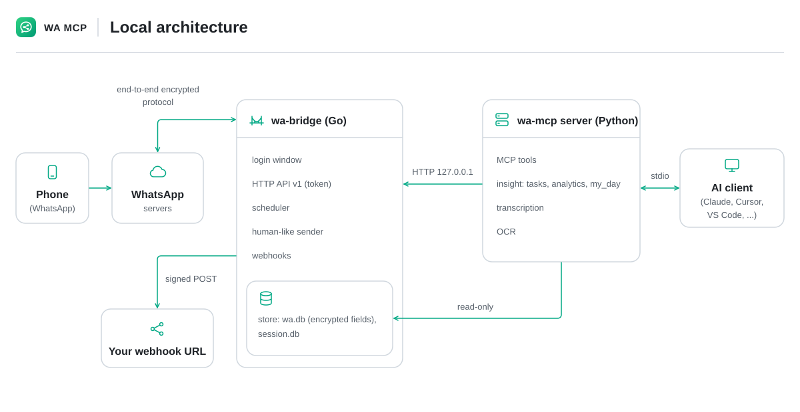

# 1. Install

Goal: build the bridge and install the MCP server on Windows, macOS or Linux. This takes about ten
minutes. Linking your account is the next tutorial.

<p align="center">
  <picture>
    <source media="(prefers-color-scheme: dark)" srcset="../../assets/diagrams/architecture-dark.svg">
    
  </picture>
</p>

Two programs work together. `wa-bridge` (Go) links to your WhatsApp account, keeps a local database and
serves a local API. `wa-mcp` (Python) is the MCP server: it reads that database and calls the API when it
needs WhatsApp.

## Prerequisites

- A computer with Windows 10 or 11, macOS or Linux, and an internet connection for the downloads.
- Permission to install programs.
- Later, for the next tutorial: a phone with the WhatsApp account you want to link.

## Steps

### 1. Install Git, Go, uv and, optionally, ffmpeg

You need Go 1.26 or newer to build the bridge, and uv to install the Python packages. uv downloads a
suitable Python for you. ffmpeg is optional now and needed later for voice notes and transcription.

Windows PowerShell:

```powershell
winget install --id Git.Git -e
winget install --id GoLang.Go -e
winget install --id astral-sh.uv -e
winget install --id Gyan.FFmpeg -e
```

macOS with [Homebrew](https://brew.sh):

```bash
brew install git go uv ffmpeg
```

Linux (Debian and Ubuntu shown). The `go` package of a distribution is often older than 1.26, so take Go
from [go.dev/dl](https://go.dev/dl/). Use the archive that matches your CPU and the newest version listed
there:

```bash
sudo apt install git ffmpeg
curl -LO https://go.dev/dl/go1.26.11.linux-amd64.tar.gz
sudo rm -rf /usr/local/go && sudo tar -C /usr/local -xzf go1.26.11.linux-amd64.tar.gz
export PATH="$PATH:/usr/local/go/bin"
curl --fail --location --output uv-install.sh https://astral.sh/uv/install.sh
sh uv-install.sh
```

Add the `export PATH` line to your shell profile so that it stays. Open a new terminal after the installs
so that the new programs are on your `PATH`.

You should see version numbers from these commands, and a Go version of 1.26 or newer:

```bash
git --version
go version
uv --version
```

### 2. Get the code

```bash
git clone https://github.com/tsahospital-beep/wa-mcp.git
cd wa-mcp
```

You should see a new folder `wa-mcp` with `bridge`, `server`, `sdk`, `docs` and other folders in it.

### 3. Build the bridge

macOS and Linux:

```bash
go build -C bridge -o ../wa-bridge ./cmd/wa-bridge
```

Windows PowerShell:

```powershell
go build -C bridge -o ../wa-bridge.exe ./cmd/wa-bridge
```

The first build downloads the Go modules, which can take a minute. You should see no output when it
succeeds, and the file `wa-bridge` (`wa-bridge.exe` on Windows) in the repository folder. The SQLite
driver is written in Go, so you do not need a C compiler.

### 4. Install the Python packages

```bash
uv sync
```

You should see uv resolve and install packages, and a `.venv` folder appear. This installs the MCP server,
the SDK and the optional packages for encryption and file text.

### 5. Check both programs

macOS and Linux:

```bash
./wa-bridge --version
uv run wa-mcp --help
```

Windows PowerShell:

```powershell
.\wa-bridge.exe --version
uv run wa-mcp --help
```

You should see `wa-bridge 0.1.0` (or the current version) and the usage text of `wa-mcp`.

### 6. Check ffmpeg, if you installed it

```bash
ffmpeg -version
```

You should see the version banner. If you skipped ffmpeg, install it before you use voice notes,
stickers or transcription. If it is installed but not on your `PATH`, set the full path in the
environment variable `WA_MCP_FFMPEG`.

## Troubleshooting

- `go`, `uv` or `git` is not found right after installing. Open a new terminal. On Linux check that
  `/usr/local/go/bin` is on your `PATH`.
- The build stops with a message about the Go version. The bridge needs Go 1.26 or newer. Check
  `go version` and install a newer Go from [go.dev/dl](https://go.dev/dl/).
- `go build` cannot download modules. Check your network and any proxy settings. `go env GOPROXY` shows
  where Go looks.
- `uv sync` fails because a package has no wheel for your Python version. Choose a version that it supports,
  for example `uv sync --python 3.13`.
- Windows says that `winget` is not found. Install App Installer from the Microsoft Store, or download the
  installers from the sites of Git, Go and uv.

## Next steps

- [First login](02-first-login.md): link your WhatsApp account.
- [Getting started](../getting-started.md): the same install as a reference page.
- [Configuration](../guides/configuration.md): every key of `config.json`.
