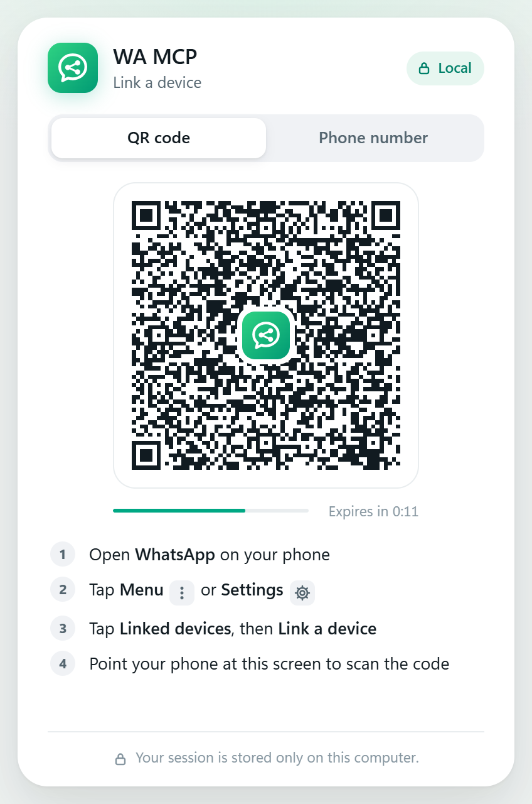
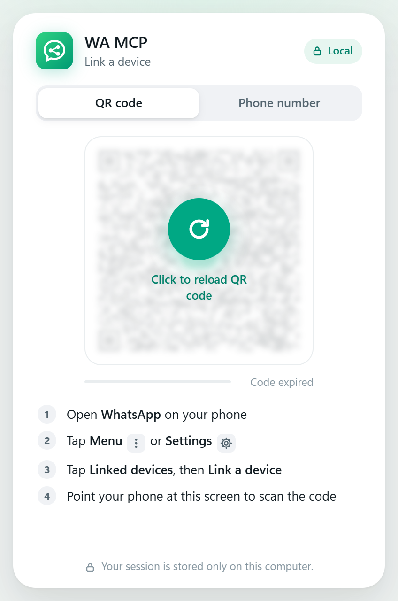
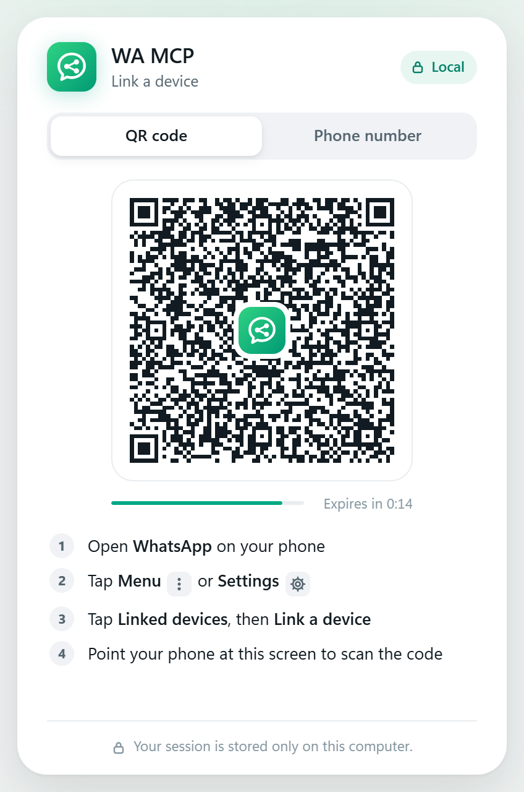
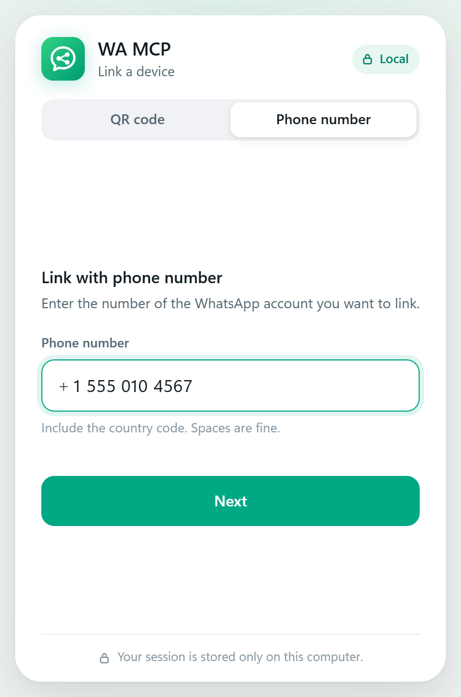
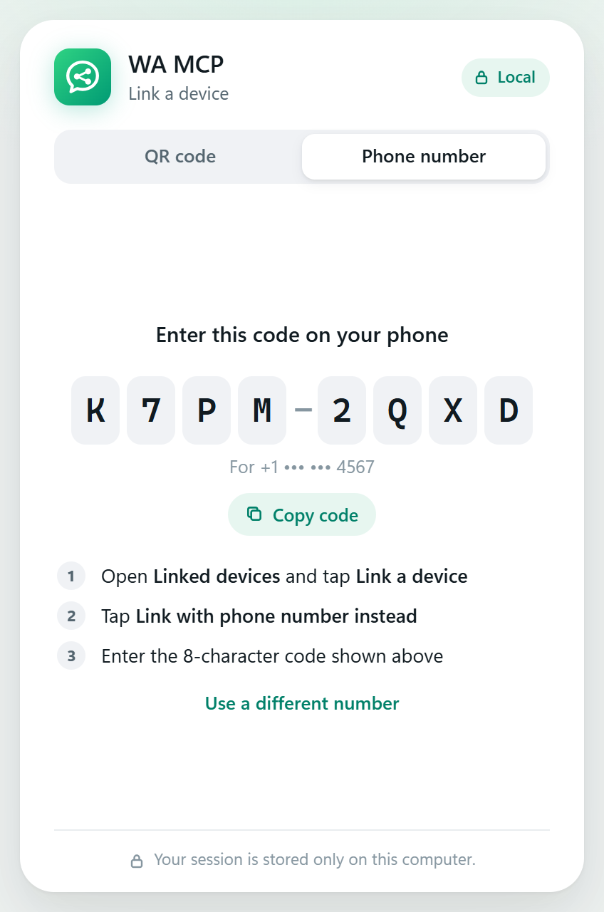
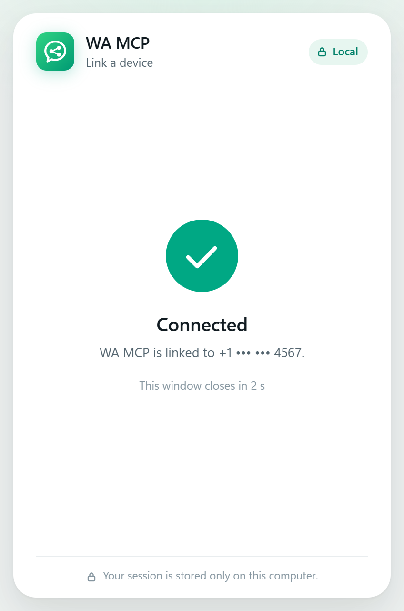

# 2. First login

Goal: link your WhatsApp account to the bridge from a small local login window, by QR code or by phone
number, and check that it is connected. This takes about five minutes.

After linking, the phone lists the device as `WA MCP` with the desktop icon by default. For phone-code
pairing, WhatsApp requires a browser and OS in the confirmation prompt. The default prompt uses Firefox.
The device name and platform take effect when linking. Re-link to change them.

## Prerequisites

- The bridge is built, see [Install](01-install.md).
- The phone with the WhatsApp account, with an internet connection.
- A supported Chromium-based browser lets the bridge open a small app window. You can also open the
  login link yourself.

## Steps

### 1. Start the bridge

Run it from the repository folder. On first start the bridge waits for you to link a device.

macOS and Linux:

```bash
./wa-bridge
```

Windows PowerShell:

```powershell
.\wa-bridge.exe
```

You should see log lines such as these, each starting with a date and time, and then a QR code drawn in
the terminal:

```text
wa-bridge 0.1.0 starting
api: listening on http://127.0.0.1:8080/api/v1
sending: disabled (set sending.enabled=true to allow it)
Login window: http://127.0.0.1:52144/?t=...
login needed: use the login window or scan the QR code below
```

A window titled WA MCP opens. The window listens on 127.0.0.1 only. Its address carries a one-time token, so
the address printed in the terminal does not work a second time.

### 2. Scan the QR code

<p>
  
  
  
</p>

On the phone open WhatsApp, tap **Menu** or **Settings**, then **Linked devices**, then **Link a device**.
Point the camera at the code in the window.

You should see a countdown under the code, for example `Expires in 0:11`. When the phone accepts the code,
the window changes to the connected view (step 5).

### 3. Reload an expired code

A code is valid for a short time. When the countdown ends, the code turns blurry and the window says
`Code expired` with the button **Click to reload QR code**. Click it. You should see a new code and a new
countdown. In the terminal, pressing Enter does the same.

### 4. Or link with the phone number

Use this when scanning is not possible, for example when the phone is the same device that shows the window.

<p>
  
  
</p>

1. Open the **Phone number** tab, enter the number of the account with the country code (spaces are fine)
   and choose **Next**.
2. The window shows an 8-character code, written like `K7PM-2QXD`, and the number it was made for with most
   digits hidden.
3. On the phone open **Linked devices**, tap **Link a device**, then **Link with phone number instead**, and
   type the code. If the number is wrong, choose **Use a different number**.

You should see the code in the window, and on the phone a prompt that asks for it.

### 5. Check that it is connected

<p>
  
</p>

When the phone confirms, the window shows **Connected** and closes itself after a moment. The bridge keeps
running. You should see a log line that starts with `device linked as`. On the phone, the list under **Linked
devices** now has an entry called `WA MCP`.

From a second terminal, ask the bridge for its status.

macOS and Linux:

```bash
curl -H "Authorization: Bearer $(./wa-bridge api-token)" http://127.0.0.1:8080/api/v1/status
```

Windows PowerShell:

```powershell
curl.exe -H "Authorization: Bearer $(.\wa-bridge.exe api-token)" http://127.0.0.1:8080/api/v1/status
```

You should see `"connected":true` and `"logged_in":true`, and your number with most digits masked. The
session is kept in `store/session.db`, so the next start connects without a login.

### 6. If no window opens: the terminal fallback

The terminal always shows the same QR code as the window. Scan it from the terminal in the same way. The line
above the code says `Scan with WhatsApp > Linked devices > Link a device`. Make the terminal wide and tall
enough for the code. Press Enter in the terminal to get a new code.

If the window did not open, or you closed it, open the address from the `Login window:` line in a browser.
Use it once. For a fresh address, run this in a second terminal while the bridge waits for a login:

macOS and Linux:

```bash
./wa-bridge login-url
```

Windows PowerShell:

```powershell
.\wa-bridge.exe login-url
```

You should see one address that starts with `http://127.0.0.1:`. Open it. This also helps when the output of
the bridge goes to a log file, because the log never contains the one-time token. To stop the window from
opening by itself, set `login.open_window` to `false` in `config.json`.

### 7. Look at the window without an account (optional)

```bash
./wa-bridge --login-preview
```

The preview shows fake codes and never connects to WhatsApp. Add `--preview-scale 0.1` to make the codes
expire ten times faster.

## Troubleshooting

- The window does not open. Open the address from the `Login window:` line, or run `wa-bridge login-url`. A
  window opens on 127.0.0.1 only, so it cannot be reached from another computer. Check that
  `login.open_window` is not `false`.
- The code expires before you can scan it. Click **Click to reload QR code** or press Enter in the terminal.
  If it keeps happening, check that the phone has an internet connection, or use the phone number tab.
- The window says `Enter the full number, including the country code`. Type the number with the country code,
  for example 15550100001. Spaces are fine.
- The bridge stops with `another bridge is using ...`. A second bridge runs on the same store folder. Stop it
  first. One store folder can be used by one running bridge.
- The bridge says `this store belongs to another WhatsApp account`. A store folder is tied to the first account
  that was linked. Use another `store_dir` for the second account, see [Several accounts](09-multiple-accounts.md).

## Next steps

- [Connect clients](03-connect-clients.md): let Claude, Cursor or VS Code use the bridge.
- [Getting started](../getting-started.md) and the [FAQ](../faq.md) for the details of syncing history.
- To start over, remove `WA MCP` under Linked devices on the phone, stop the bridge and delete the `store`
  folder. The next start shows the login window again.
