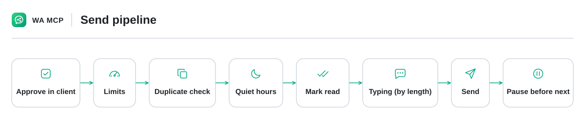

# 8. Scheduled and human-like sending

Goal: turn sending on with guard rails, see how a send is approved and paced, set limits and quiet hours,
and schedule a message that the bridge sends later. This takes about twenty minutes.

Sending is off by default. When it is on, the assistant can write to real people in your name. Automated use
of a WhatsApp account may go against the WhatsApp terms of service, and WhatsApp can limit or block
accounts. The pacing in this tutorial makes automated sending look less mechanical. It does not guarantee
anything. Try everything with your own number first.

<p align="center">
  <picture>
    <source media="(prefers-color-scheme: dark)" srcset="../../assets/diagrams/send-pipeline-dark.svg">
    
  </picture>
</p>

## Prerequisites

- A client is connected, see [Connect clients](03-connect-clients.md).
- Your own phone number with the country code. Messages to yourself appear in the "message yourself" chat.

## Steps

### 1. Enable sending

Set `sending.enabled` in `config.json`:

```json
{
  "sending": { "enabled": true }
}
```

You can set the environment variable `WA_MCP_SENDING_ENABLED=true` for the bridge and the server instead.
Restart the bridge and the client. You should see this line in the bridge log:

```text
sending: enabled (limits 20/chat/hour, 60/hour, 300/day; human-like pacing true)
```

### 2. Send a first message and see the approval

Ask the assistant: "Send the message test one to my own number, 15550100001." With
`sending.require_confirm` on (the default) you should see a question from your client before anything goes
out. It shows the recipient with the address and where the name comes from, the full text, the people
mentioned, the quoted message and the file name. Read it and approve.

If your client cannot ask questions, nothing is sent. You can then set `sending.allow_confirm_flag` to
`true`. The tool takes a `confirm=true` argument that the model sets itself, so a model that follows
instructions hidden in a message can set it without asking you. That is a weaker check. Leave it off if your
client asks.

Recipients can be a JID, a phone number with country code, an alias from `people.aliases`, or the exact name
of a contact in your address book. A group can only be addressed by its JID. Push names and chat titles are
never used to pick a recipient. If a name matches several people, nothing is sent and the assistant gets
the candidates.

### 3. Watch the human-like pacing

With `sending.human_like` on (the default) the bridge works like this for each text:

1. It checks the recipient, files, limits, duplicates and quiet hours.
2. It marks the latest unread messages of the chat as read.
3. It waits a random 0.4 to 1.5 seconds, as if reading.
4. It shows the typing indicator for the length of the text divided by `sending.typing_chars_per_second`
   (7), kept between 1.2 and 20 seconds and varied by plus or minus 30 percent.
5. It stops the indicator and sends.

You can see the time that this took through the HTTP API. Send a text and read `waited_ms` in the answer.

macOS and Linux:

```bash
curl -X POST -H "Authorization: Bearer $(./wa-bridge api-token)" -H "Content-Type: application/json" \
  -d '{"to":"15550100001","text":"Pacing test"}' http://127.0.0.1:8080/api/v1/send
```

Windows PowerShell. Put the body in a file, because quoting JSON on the command line is fragile here:

```powershell
'{"to":"15550100001","text":"Pacing test"}' | Set-Content -Encoding ascii body.json
curl.exe -X POST -H "Authorization: Bearer $(.\wa-bridge.exe api-token)" -H "Content-Type: application/json" -d "@body.json" http://127.0.0.1:8080/api/v1/send
```

You should see `"ok": true`, a message `id` and `waited_ms` of several seconds. The call returns only after
the waits, so a client timeout of three minutes is sensible. Add `"human": false` to the body to skip the
waits for one request. Limits and duplicate protection still apply. The MCP tools always use the pacing of
your config.

### 4. Set limits

```json
{
  "sending": {
    "limits": { "per_chat_per_hour": 10, "per_hour": 30, "per_day": 100 },
    "dedupe_window_minutes": 10
  }
}
```

The bridge counts every send, whichever client made it. A reached limit gives HTTP 429 with
`send limit reached: per_hour=30`. The same text or file to the same chat inside the duplicate window gives
409. A limit of `0` means no limit. The counters are kept in the database, so they survive a restart.

### 5. Set quiet hours

```json
{
  "sending": {
    "quiet_hours": { "enabled": true, "start": "22:00", "end": "08:00", "action": "queue" }
  }
}
```

The times are the local time of the machine that runs the bridge, and the window may cross midnight. With
`queue`, a message sent inside the window is stored as a scheduled message for the end of the window. The API
answers 202 with `"queued": true` and a `scheduled_id`. With `refuse` the send fails with 403. Scheduled
messages are not held back by quiet hours, because you chose their time.

### 6. Schedule a message

Ask: "Schedule the message Good morning to my own number for five minutes from now." The assistant calls
`schedule_message` with `to`, `at` (an ISO 8601 time or unix seconds) and `text`. `recurrence` can be
`once`, `daily`, `weekly` or `monthly`. You approve it like any send.

Then ask: "List my scheduled messages." You should see the entry as `pending`. After its time, with the
bridge running and connected, it becomes `sent` and the message appears in the chat. The bridge looks for due
messages every 15 seconds and sends even if no assistant is open. Cancel a pending entry by asking: "Cancel
scheduled message 7", which calls `cancel_scheduled_message`.

A failed send is tried up to five times, with waits of 1, 5, 15 and 30 minutes. A run that the bridge missed
while it was off is sent once, not once per missed run.

### 7. Send a file

Files must be regular files inside `downloads_dir`, `exports_dir` or a folder in
`sending.allowed_media_dirs`. Files in the store folder and the config file are never sent. Copy a picture
into `exports`, then ask: "Send exports/picture.jpg to my own number with the caption hello." The assistant
calls `send_file`. Voice notes need Ogg/Opus and stickers need WebP. The MCP tools convert other formats with
ffmpeg.

### 8. Turn read receipts on or off

Reading through an assistant does not mark messages as read. Ask: "Mark the latest message from Alice as
read." The assistant calls `mark_messages_read`. To mark every new message as read when it arrives, set
`read_receipts.auto_mark_read` to `true`. To forbid read receipts on request, set
`read_receipts.allow_mark_read` to `false`.

### 9. Turn sending off again

Set `sending.enabled` to `false` and restart the bridge and the client when you do not need it. You should
see `sending: disabled` in the bridge log, and the send tools answer `sending is disabled`.

## Troubleshooting

- `sending is disabled`. Set `sending.enabled` to `true` and restart both the bridge and the client.
- The client does not show a question. With `sending.require_confirm` on and no `allow_confirm_flag`, a
  client that cannot ask sends nothing. Check the first send in each new client.
- `send limit reached`. Wait for the hour to pass or raise the limit. A duplicate (409) means the same text
  went to the same chat within `dedupe_window_minutes`.
- A file is refused. It is outside the allowed folders, or it is in the store folder, or it has more than
  one hard link. Copy it into `exports`.
- A scheduled message stays `pending`. The bridge is not running, not connected, or sending is off. Entries
  that are due are sent as soon as the bridge is connected again.

## Next steps

- [Sending](../guides/sending.md): every setting, the order of the checks and the retry rules.
- [Webhooks and the Python SDK](12-webhooks-and-python-sdk.md): send from your own code.
- [Security hardening](13-security-hardening.md): keep the assistant's reach small.
