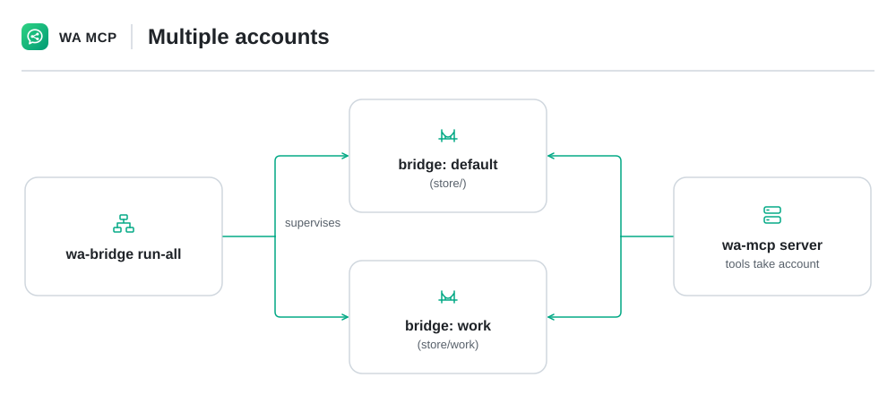

# 9. Multiple accounts

Goal: use more than one WhatsApp number with one MCP server, for example a personal and a work number. Each
number runs its own bridge with its own store folder and API address. This takes about fifteen minutes.

<p align="center">
  <picture>
    <source media="(prefers-color-scheme: dark)" srcset="../../assets/diagrams/accounts-dark.svg">
    
  </picture>
</p>

## Prerequisites

- The first account is linked and works, see [First login](02-first-login.md). You do not link it again.
- A phone with the second number.

## Steps

### 1. Describe the second account

The account `default` always exists and keeps the top-level settings, so you only describe the new number.
Add an `accounts` block to `config.json`:

```json
{
  "sending": { "enabled": true },
  "accounts": {
    "work": {
      "api": { "listen": "127.0.0.1:8081" },
      "sending": { "limits": { "per_hour": 20, "per_day": 100 } }
    }
  }
}
```

An account other than `default` gets its own subfolder for the store, downloads and exports (for example
`store/work`) unless you set them. `api.listen` is required, and every account needs its own port. The
`sending` keys of the block are merged over the top-level `sending`. Webhooks, encryption, transcription and
the insight settings are shared. Account names use `a` to `z`, `0` to `9`, `-` and `_`, at most 32
characters. The bridge and the server refuse a config in which two accounts share a store folder, an API
port or a login port.

### 2. See the accounts

macOS and Linux:

```bash
./wa-bridge accounts
```

Windows PowerShell:

```powershell
.\wa-bridge.exe accounts
```

You should see one row per account:

```text
ACCOUNT  STORE       API             STATUS
default  store       127.0.0.1:8080  running, connected, linked, +1 ••• ••• 0101
work     store/work  127.0.0.1:8081  not running, not linked
```

The command reads the status from each bridge through its API. For a bridge that does not run, it opens the
session file read-only and creates nothing.

### 3. Start the bridges

One bridge per account. In two terminals:

```bash
./wa-bridge                      # the account "default"
./wa-bridge --account work       # the account "work"
```

Or let one command run all of them:

```bash
./wa-bridge run-all
```

On Windows use `.\wa-bridge.exe`. `run-all` checks every account first and stops with a message when a block
is wrong. Then it starts one bridge process per account and prefixes their output with the account name,
for example `[work]`. When a bridge stops, it starts it again after 1 second, then 2, 4 and so on up to 60
seconds. Ctrl+C shuts all of them down. You should see `[work]` lines and, for the new number, the login
window.

### 4. Link the second number

A new account shows its own login window the first time its bridge starts. The subtitle names the account:
`Link a device: work`. Click the account name in the window to see the other accounts and open the login
window of another one. The menu says `Already linked` for a linked number and `Bridge not running` when its
bridge does not answer. Link the number as in [First login](02-first-login.md).

To get a fresh login link for one account, or to look at the window without WhatsApp:

```bash
./wa-bridge login-url --account work
./wa-bridge --login-preview --account work
```

Run `./wa-bridge accounts` again. You should see `running, connected, linked` for `work`.

### 5. Use the accounts from an assistant

The MCP server reads the same `config.json` and needs no extra setup. Restart the client, then ask:
"List my WhatsApp accounts." The assistant calls `list_accounts`. You should see each account with `linked`,
`bridge_running`, `connected`, the masked number and the store folder.

- Every tool takes an optional `account`. Without it a tool works on `default`. Ask: "Search the work account
  for invoice." The assistant calls `list_messages` with `account` set to `work`.
- `my_day` without `account` covers all accounts. Every group and item then has an `account` field.
- Send tools use the sending settings of the chosen account, and the approval question names the account
  that the message goes out from.
- Sending limits, quiet hours and duplicate checks are counted per number, because every bridge keeps its own
  store.

With one account the tools behave as before and the server instructions do not mention accounts.

### 6. Use the accounts from Python

```python
from wa_mcp import accounts, config, db

accounts.connect(config.load("config.json"))
for name in accounts.names():
    with accounts.use(name) as h:
        print(name, h.cfg.store_dir, len(db.messages(query="invoice", limit=5)))
```

To call the bridge of one account, use `Bridge(cfg=cfg, account="work")`.

## Troubleshooting

- The bridge or the server refuses the config. Two accounts share a store folder, an API port or a login
  port, or a name uses characters that are not allowed. The message names the key.
- `this store belongs to another WhatsApp account`. A store folder is tied to the first number that was
  linked. Give each account its own `store_dir`, which is the default for accounts other than `default`.
- The login menu says `Bridge not running` for an account. Start that bridge, or run `wa-bridge run-all`.
- An environment variable such as `WA_MCP_STORE_DIR` or `WA_MCP_API_LISTEN` changes the top-level settings,
  and a value in an account block wins for that account. Check the variables if an account uses a surprising
  folder or port.
- `login.public` (the login page behind a proxy) is one address for the whole config, so it suits a single
  account.

## Next steps

- [Several accounts](../guides/accounts.md): every rule in one page.
- [Scheduled and human-like sending](08-scheduled-and-human-like-sending.md): limits per number.
- [Configuration](../guides/configuration.md#accounts): the keys under `accounts`.
