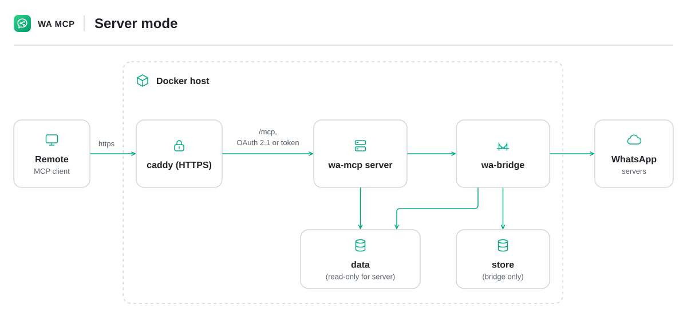

# 10. Server with Docker

Goal: run the bridge and the MCP server on a Linux server with Docker, with HTTPS for your domain, so that
MCP clients can reach your WhatsApp from anywhere, also while your computer is off. This takes about thirty
minutes.

The images have yet to be built on a real Docker host. On pushes to `main`, CI builds both images and
checks the preview stack without connecting to WhatsApp. For all settings, see
[Run on a server](../guides/server.md).

<p align="center">
  <picture>
    <source media="(prefers-color-scheme: dark)" srcset="../../assets/diagrams/server-mode-dark.svg">
    
  </picture>
</p>

## Prerequisites

- A Linux server with Docker Engine and the Compose plugin.
- A domain or subdomain with an A (or AAAA) record that points to the server, for example `wa.example.com`.
- Ports 80 and 443 open in the firewall. Keep every other port closed.
- Your phone with the WhatsApp account.

All commands below run on the server, for example over SSH.

## Steps

### 1. Get the code and write the settings

```bash
git clone https://github.com/tsahospital-beep/wa-mcp.git
cd wa-mcp/deploy/docker
cp env.example .env && chmod 600 .env
```

Set `WA_MCP_DOMAIN` in `.env` to your domain. Keep the default `keyfile` encryption mode.
Create the database key before starting either container.

```bash
sh secrets/make-key.sh
```

The script creates `secrets/wa_mcp.key` for user 65532. Back it up separately from the data volumes.
Both containers read it as `/run/secrets/wa_mcp_key`.

### 2. Build and start

```bash
docker compose --profile caddy up -d --build
docker compose ps
```

Wait for `bridge` and `server` to show `healthy` and for Caddy to obtain the certificate.
Check the public health endpoint.

```bash
curl https://wa.example.com/health
```

You should see `{"ok": true}`.

### 3. Link WhatsApp

Ask the bridge for a one-time link to its login page:

```bash
docker compose exec bridge wa-bridge login-url
```

You should see a link such as `https://wa.example.com/login/?t=...`. Open it in your browser and scan the QR
code with WhatsApp on your phone: **Settings**, **Linked devices**, **Link a device**. The link works once.
Run the command again for a new one. The bridge log shows the QR code too:

```bash
docker compose logs -f bridge
```

Open the link right away. Whoever opens a fresh link while the bridge waits for a login could link their own
phone to your server.

### 4. Check the connection

```bash
docker compose exec bridge wa-bridge health
docker compose logs --tail 20 server
```

The first command exits with 0 on a successful health check. Run `docker compose exec bridge wa-bridge accounts`
to see whether the account is linked and connected.

### 5. Try the stack without WhatsApp (optional)

Run this step before starting the live stack, or on a separate Docker host. The preview uses the same
Compose project and network. It starts the bridge with fake QR codes and no connection to WhatsApp.

```bash
WA_MCP_DOMAIN=wa.example.test WA_MCP_PORT= \
  docker compose -f compose.yaml -f compose.preview.yaml up -d --build
docker compose -f compose.yaml -f compose.preview.yaml ps
```

Both services become healthy. Use this to check Docker, ports and health checks before you link a real
account. Stop it with `docker compose -f compose.yaml -f compose.preview.yaml down`.

### 6. Update, back up, read logs

- Update: `git pull`, then `docker compose --profile caddy up -d --build`.
- For a backup, stop the stack with `docker compose --profile caddy stop` and copy both `wa-data` and
  `wa-session`. The latter contains the linked device keys. Keep the backups encrypted.
- Logs: `docker compose logs -f server` shows approval links and OAuth events, and
  `docker compose logs -f bridge` shows the connection and the QR code. Neither prints tokens.
- To unlink, remove the device under Linked devices on your phone. To also delete the project's volumes,
  run `docker compose --profile caddy down -v`.

## Troubleshooting

- A container is not healthy. Run `docker compose logs bridge` and `docker compose logs server` and read the
  last lines. Check that `.env` sets `WA_MCP_DOMAIN` and that `secrets/wa_mcp.key` exists with mode
  0600 and owner 65532.
- Caddy cannot get a certificate. Check that the A record points to the server, and that ports 80 and 443
  are open and not used by another program.
- The login link says it is invalid. Each link works once, and the login page runs only while no device is
  linked. Run `wa-bridge login-url` again.
- The server answers 421 or 403 behind your own proxy. Keep the `Host` header and set
  `server.trusted_proxies`. See the section Without Caddy in [Run on a server](../guides/server.md).
- If the database key is lost, restore `secrets/wa_mcp.key` from its backup to read the encrypted messages.

## Next steps

- [Connect remotely](11-connect-remotely.md): create a token or approve a claude.ai connector.
- [Run on a server](../guides/server.md): settings, key files, Docker secrets, a proxy you already run, and
  an SSH tunnel for a setup without a domain.
- [Remote mode security](../security/remote.md): what protects the server and what does not.
